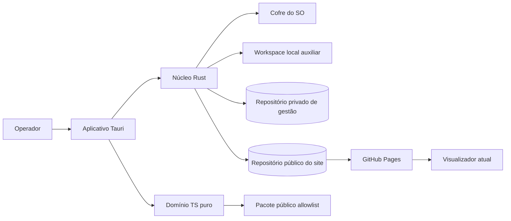
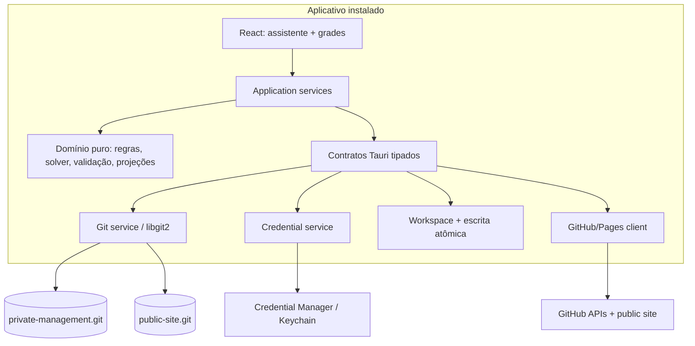
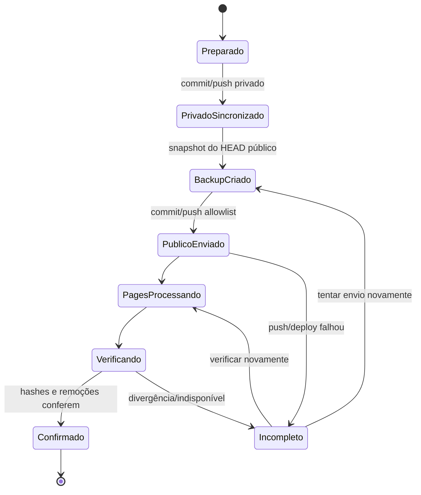

# Documento de Desenho Técnico — Gestão Leiga de Escalas

## Overview

### Objetivo

O `gestao-leiga-de-escalas` será um aplicativo desktop instalado, em português, para Windows e macOS. Ele substituirá a operação mensal por scripts e edição de JSON/Markdown por um fluxo visual de sete etapas: abertura, coleta, montagem, validação, aprovação, publicação e fechamento. O visualizador estático atual continuará sendo o produto público e continuará consumindo `atual.json` e `contatos.json`.

A solução escolhida é **Tauri 2 com interface React + TypeScript e núcleo local em Rust**. A interface usará grades semelhantes a planilhas, formulários laterais, validação célula a célula e um assistente de publicação. O núcleo Rust concentrará acesso a arquivos, Git, credenciais, geração determinística, validação e publicação. A lógica de domínio independente de sistema operacional ficará em TypeScript puro quando isso simplificar testes e reaproveitamento; operações privilegiadas ficarão exclusivamente em comandos Rust de superfície pequena e tipada.

### Premissas revisáveis e defaults conservadores

As perguntas remanescentes não bloqueiam a arquitetura. A implementação começará com estes defaults, todos versionados na configuração operacional e revisáveis antes da homologação:

| Tema | Default de desenho | Justificativa |
|---|---|---|
| Windows mínimo | **Windows 10 versão 22H2, 64 bits** | Ainda recebe uma experiência previsível de WebView2 e reduz combinações antigas; deve ser confirmado com as máquinas reais. |
| macOS mínimo | **macOS 12 Monterey, Intel e Apple Silicon** | Equilibra cobertura de máquinas ainda comuns e custo de testes; deve ser confirmado com as máquinas reais. |
| Nomes públicos | Publicar somente o nome canônico usado na escala; aliases ficam privados por padrão | Minimiza exposição e ainda mantém o visualizador funcional. Um alias só será público por autorização explícita. |
| Telefones públicos | Negado por padrão; permitido por pessoa, telefone, finalidade e vigência | Aplica minimização e atende às autorizações exigidas. |
| Indisponibilidade | Digitação manual em grade por pessoa × data, com opção “mês inteiro” | Não exige IA nem importação; uma futura importação de planilha pode usar o mesmo contrato. |
| Conciliação de regras | Nenhuma fonte vence silenciosamente. Cada divergência vira item pendente; a decisão aprovada forma a versão inicial | Evita consolidar erros legados como regra oficial. |
| Exceções emergenciais | Somente exceções explicitamente permitidas pelo tipo da Regra Fundamental; sem catálogo aprovado, nenhuma RF aceita exceção | Default mais seguro. Preferências aceitam justificativa, não “exceção”. |
| Campos obrigatórios | Derivados por tipo de culto na versão inicial de regras; ausência de decisão vira bloqueio de migração, não suposição | Evita publicar uma escala aparentemente completa com semântica indefinida. |
| Retenção | Commits e versões oficiais: indefinidos; backups de aprovação/publicação: 24 meses ou 24 ciclos, preservando todos os marcados oficiais | Git continua sendo histórico; limpeza nunca remove publicação oficial. |
| Offline | Cadastro, coleta, montagem, validação, prévia e treinamento funcionam sobre cópia local; aprovação final, commit/push confirmado, publicação e verificação pública exigem internet | Mantém trabalho útil offline sem fingir sincronização. |
| WhatsApp pós-publicação | Gerar links e registrar que foram gerados; não controlar respostas na v1 | Preserva o fluxo atual sem ampliar o escopo. |
| Assinatura | Builds de homologação podem ser internas; distribuição ao operador exige assinatura Windows e assinatura + notarização macOS | Um usuário leigo não deve contornar alertas de segurança. |

### Análise do repositório atual

A análise do repositório encontrou uma separação útil entre visualizador (`src/`) e automação (`scripts/`), mas também confirmou os riscos descritos nos requisitos:

- O visualizador é uma aplicação estática sem bundler. `src/data/loader.js` busca exatamente `atual.json` e `contatos.json` e usa cache local. A tabela e os cartões leem as chaves legadas em português e caixa alta. Portanto, o novo modelo interno não deve substituir esse contrato público; deve exportá-lo.
- `atual.json` é um array, com datas `DD/MM/YYYY`, nomes agregados por vírgula e os campos `DATA`, `DIA SEMANA`, `ACOMP`, `REGENTE LOUVOR`, `EQUIPE LOUVOR`, `MENSAGEM MUSICAL`, `LOUVORES ES`, `LOUVORES CULTO`, `TEMA CULTO`, `AUDIOVISUAL`, `ANCIÃO`, `PREGADOR`, `SUPORTE` e `OBS`.
- `contatos.json` é um objeto indexado por nome, com `telefone` em URL `https://wa.me/...` e `apelidos`. O novo exportador manterá esse formato, mas aplicará autorizações públicas antes de incluir nome, aliases ou telefone.
- `pessoas.json` já introduz IDs estáveis e habilitações, mas mistura pessoas e entidades que deveriam ser departamentos, possui telefone sem `+`, afastamento singular e aliases divergentes. Ele será fonte de migração, não o modelo final.
- `iniciar-mes.js` gera somente sábados no `acionato.json`; os requisitos pedem quartas, sábados e domingos. O aplicativo gerará o calendário gregoriano completo diretamente no modelo.
- `vincular-indisponibilidade.js` aceita automaticamente o melhor fuzzy match acima de 0,6 e propaga vínculos. Isso explica o risco de associação errada. No novo desenho, correspondência aproximada nunca grava vínculo: apenas cria candidatos pendentes para escolha explícita.
- O solver atual já tem qualidades reaproveitáveis como filtros, score explícito e desempate por ID. Porém, regras consideradas “fundamentais” aparecem como penalidades ou avisos em alguns pontos, departamentos são uma constante fixa e justificativas não guardam a versão completa das entradas. A nova implementação separará elegibilidade bloqueante de ordenação preferencial e produzirá um traço determinístico.
- `validar-rascunho.js` valida apenas duplicidade regente/equipe e procura `indisponiveis_contatos`, enquanto o vinculador produz `indisponiveis_ids` e `indisponiveis_nomes`. O novo validador usará IDs canônicos e um único esquema tipado.
- `publicar-fechamento.js` promove primeiro, valida depois e em seguida remove arquivos. Também inicia um servidor local. O novo publicador será uma máquina de estados: preparar, validar, fazer backup, enviar, verificar o Pages e somente então confirmar/fechar.
- `publicar-escala-mensal.js` altera `atual.json` diretamente e infere destinos por caminho; `controle-rotacao-utils.js` contém períodos e saídas fixos em 2026. O novo núcleo derivará histórico de publicações confirmadas e identificadas, sem incrementos mutáveis.
- O workflow atual envia `path: '.'` ao GitHub Pages. Isso expõe tudo que estiver no repositório. A separação física dos repositórios e uma allowlist fechada de artefatos eliminam esse risco.
- Existem fontes de regras divergentes (`docs/resumo.md`, `docs/regras/REGRAS.md`, `docs/regras/regras.json`, snapshots/processos e cadastro legado). A migração deve produzir relatório por regra e exigir decisão para conflitos.

### Pesquisa técnica e decisão de plataforma

A decisão considerou instalador, tamanho, manutenção, assinatura, compatibilidade, segurança e custo:

| Critério | Tauri 2 | Electron | Aplicação local no navegador/PWA |
|---|---|---|---|
| Instalação leiga | Gera instaladores nativos; WebView2 pode ser instalado pelo bootstrapper no Windows | Instaladores maduros, mas levam um runtime Chromium completo | Instalação de PWA varia por navegador; acesso a diretórios, Git e cofre é limitado ou exige serviço auxiliar |
| Tamanho e memória | Menores por reutilizar WebView2/WebKit do sistema | Maiores por empacotar Chromium e Node | Menor distribuição, mas transfere complexidade para navegador/serviço local |
| Código existente | Interface web pode ser reaproveitada conceitualmente; exige ponte Rust pequena | Maior reaproveitamento JavaScript/Node dos scripts | Reaproveita UI, mas não satisfaz bem Git local, cofre do SO e arquivos sem permissões recorrentes |
| Segurança | Capabilities e comandos nativos explícitos permitem negar acesso arbitrário a shell e filesystem | Processo Node exige isolamento rigoroso, context isolation e IPC restrita | Tokens tenderiam a ficar no armazenamento do navegador; não há cofre nativo portátil confiável |
| Git e offline | `libgit2`/Rust permite repositório local, commits, merges e push sem CLI | Bibliotecas Node também resolvem, com runtime maior | Git completo e credenciais seguras exigem backend/daemon, contrariando simplicidade e custo |
| Assinatura | Necessária para experiência leiga; macOS exige assinatura/notarização e conta Apple | Mesma obrigação prática; Electron documenta que apps não assinados exigem passos manuais avançados | Sem binário principal, mas um helper nativo voltaria a exigir assinatura |
| Manutenção | Dois ecossistemas (TS/Rust), porém superfície nativa pequena e menor pacote | Um ecossistema principal JS, maior frequência de atualização do Chromium | Muitas diferenças de navegador e APIs incompletas para o caso |
| Custo recorrente | Sem servidor; há custos de certificados/conta de distribuição | Sem servidor; mesmos custos de assinatura | Sem servidor, mas não atende os controles nativos sem componente adicional |

**Escolha:** Tauri 2. Electron seria a segunda opção se a equipe não puder manter Rust. O custo de empacotar e atualizar Chromium não se justifica para uma aplicação de formulários e regras. A aplicação apenas no navegador foi descartada porque a combinação de Git real, cofre do sistema, cópias locais, offline e fluxo sem terminal exigiria um serviço auxiliar, recriando um desktop app de forma mais frágil.

A documentação do Tauri lista suporte técnico amplo, inclusive macOS 10.15+ e Windows 7+, e usa WebView2 no Windows; o desenho adota mínimos mais conservadores e revisáveis para reduzir a matriz de suporte ([pré-requisitos Tauri](https://v2.tauri.app/start/prerequisites/)). A documentação do Electron confirma a necessidade prática de assinatura nas duas plataformas e assinatura + notarização no macOS ([assinatura Electron](https://www.electronjs.org/docs/latest/tutorial/code-signing)). O GitHub recomenda GitHub Apps por permissões granulares, seleção de repositórios e tokens de curta duração ([comparação oficial](https://docs.github.com/en/apps/creating-github-apps/creating-github-apps/differences-between-github-apps-and-oauth-apps)). O fluxo de dispositivo não embute segredo de cliente e fornece uma autenticação guiada no navegador ([autorização GitHub](https://docs.github.com/en/apps/oauth-apps/building-oauth-apps/authorizing-oauth-apps)).

Conteúdo das fontes externas foi reformulado para cumprir restrições de licenciamento.

### Princípios do desenho

1. **Git remoto privado é a autoridade.** A cópia local é um workspace durável e uma fila offline, nunca uma autoridade concorrente silenciosa.
2. **IDs no domínio, nomes somente na borda.** Regras, indisponibilidades e atribuições usam IDs; nomes formatados existem na UI e no artefato legado.
3. **Nada público por acidente.** O pacote nasce de uma projeção por allowlist; nenhum arquivo privado é copiado e depois filtrado.
4. **Validação e sugestão são puras.** Mesmas entradas versionadas geram os mesmos resultados e traços.
5. **Publicação é uma saga recuperável.** Não há transação distribuída entre dois repositórios e Pages; cada passo é idempotente, registrado e retomável.
6. **Sem shell.** O aplicativo não expõe terminal e não monta comandos de usuário. Git é chamado por biblioteca.
7. **Toda decisão destrutiva é pré-visualizada.** Restauração, conciliação, remoção e publicação mostram origem, destino e diferenças antes da confirmação.

## Architecture

### Visão de contexto



### Contêineres e módulos



### Estrutura proposta dos repositórios

**Repositorio_Privado_Gestao**

```text
state/
  schema-version.json
  config/operational.json
  registry/people/*.json
  registry/departments/*.json
  rules/versions/{ruleSetId}.json
  cycles/YYYY-MM/cycle.json
  cycles/YYYY-MM/services/*.json
  cycles/YYYY-MM/inputs/*.json
  cycles/YYYY-MM/draft.json
  cycles/YYYY-MM/revisions/*.json
  approvals/*.json
  publications/*.json
  audit/YYYY/*.jsonl
  backups/{backupId}/manifest.json
  backups/{backupId}/payload/*.json
migration/
  source-manifest.json
  reports/*.json
training/
  fixtures/**
```

Arquivos pequenos por entidade reduzem conflitos entre máquinas. Todos usam JSON canônico UTF-8, final de linha LF, chaves ordenadas e arrays ordenados somente quando a ordem não tiver significado. Auditoria anual em JSON Lines evita reescrever um arquivo global; cada evento tem ID idempotente.

**Repositorio_Publico_Site**

```text
index.html
src/**                 # somente módulos necessários ao visualizador atual
assets/**              # se existentes e aprovados
atual.json
contatos.json
config.json            # somente configuração pública aprovada
```

O repositório público não recebe `pessoas.json`, regras, backups, insumos, indisponibilidades, auditoria, justificativas ou credenciais. A branch configurada publica a raiz estática. A migração manterá a URL pública existente quando possível; se o repositório precisar mudar, a URL aprovada será atualizada na configuração antes da homologação.

### Estado local e persistência

O aplicativo mantém dois clones em seu diretório de dados, nunca ao lado dos documentos do usuário:

- `workspaces/private`: clone auxiliar do repositório privado;
- `workspaces/public`: clone auxiliar do repositório público;
- `pending/`: journal local de operações offline ainda não confirmadas no Git remoto;
- `cache/`: índices reconstruíveis e resultados de validação;
- `recovery/`: arquivos temporários com manifesto e checksum, removidos após conclusão segura.

Uma alteração online segue: obter/fetch remoto → confirmar que `baseCommit` ainda é o HEAD → aplicar comando puro → escrever em diretório temporário → validar esquema e invariantes → troca atômica → commit com `operationId` → push fast-forward → marcar como confirmada. Se o push falhar, o commit e a operação ficam pendentes e a UI não declara sincronização.

Uma alteração offline é rotulada **“Salva neste computador, aguardando sincronização”**. Ela recebe `operationId`, `baseCommit`, comando e hash do resultado. Na reconexão, o sincronizador faz fetch. Se o HEAD não mudou, reaplica e envia. Se mudou, inicia conciliação guiada.

### Concorrência e conciliação entre máquinas

O controle é otimista, adequado a uma única pessoa em mais de uma máquina:

1. Cada comando registra o SHA remoto de origem.
2. Antes do push, o aplicativo busca o HEAD remoto e bloqueia push se ele difere.
3. O reconciliador calcula base/local/remoto por entidade e campo.
4. Mudanças em entidades/campos distintos são combinadas automaticamente, mas apresentadas para conferência.
5. Mudanças no mesmo campo, exclusão versus alteração, mudança de versão de regras ou duas aprovações/publicações exigem escolha explícita.
6. A tela mostra “Neste computador”, “No GitHub” e “Resultado”. O operador escolhe a origem por conflito e revisa o diff final.
7. O resultado passa por validação completa, recebe novo commit com referências aos dois heads e só então pode ser enviado.
8. O aplicativo nunca usa force-push e nunca substitui automaticamente uma versão divergente.

Estados especiais como aprovação, pacote e publicação não são mesclados campo a campo. A revisão local deve ser refeita sobre a revisão escolhida; qualquer mudança invalida validação, prévia e aprovação derivadas.

### Autenticação e credenciais GitHub

Será registrado um **GitHub App** instalável somente nos dois repositórios aprovados, com permissões mínimas: Contents read/write nos dois repositórios, Metadata read e Actions/Pages read somente quando necessário para consultar publicação. Cada repositório terá ruleset que limita a identidade do aplicativo à branch operacional aprovada e bloqueia force-push; o backend também recusa qualquer ref diferente antes de entregar credencial à biblioteca Git. A restrição efetiva resulta da seleção de repositórios do GitHub App, dos rulesets remotos e do gate local, e será comprovada em teste com outro repositório e outra branch. O login usa fluxo de dispositivo: o aplicativo abre a página oficial, mostra o código e aguarda autorização. Não há client secret no binário.

Tokens de acesso e renovação ficam no **Windows Credential Manager** ou **macOS Keychain**, acessados pelo núcleo Rust. O workspace, logs, auditoria, backup, clipboard e UI nunca recebem o valor. A UI mostra apenas estado, conta, repositórios autorizados e expiração. Remover acesso apaga as entradas do cofre e limpa credenciais em memória. O aplicativo valida a identidade e a instalação após autenticar e antes de cada operação sensível.

O plugin Stronghold não é a escolha principal porque mantém um cofre criptografado próprio; o requisito pede o cofre do sistema operacional. O adaptador de credenciais terá interface própria para permitir trocar a biblioteca nativa sem afetar o domínio.

### Fluxo mensal na interface

A tela inicial mostra os ciclos e um assistente horizontal fixo. Cada etapa tem status, pendências e botão “O que fazer agora?”.

1. **Abertura:** seletor mês/ano; prévia das quartas, sábados e domingos; inclusão de culto extraordinário e remoção com motivo.
2. **Coleta:** abas tipo planilha para ancião/pregador, sonoplastia, músicas/tema/pedidos, observações e indisponibilidade. PDF é apenas referência visual aberta externamente; os dados são digitados e conferidos em uma tela-resumo.
3. **Montagem:** grade por culto com células de seleção; painel de candidatos mostra habilitação, disponibilidade, histórico, score e regras. “Gerar sugestão completa” preenche uma cópia editável.
4. **Validação:** lista agrupada por culto e células destacadas. Cada problema explica regra, motivo e ação. Clique leva à célula.
5. **Aprovação:** prévia pública com alternância “Como tabela/Como cartões” e diff contra a vigente; avisos exigem caixas individuais de ciência.
6. **Publicação:** resumo dos dois destinos, branches e arquivos; autenticação, sincronização do privado, backup público, commit/push público, Pages e comparação de conteúdo em passos separados.
7. **Fechamento:** somente após verificação pública. Registra publicação, deriva rotação, gera links de WhatsApp e cria backup. Nenhum insumo é apagado automaticamente.

### Fluxo de publicação recuperável



Cada transição usa `publicationId` e é idempotente. O pacote aprovado é imutável e inclui hashes SHA-256. O commit público contém apenas inclusões, alterações e remoções do manifesto. Após o push, o cliente consulta o estado do Pages quando disponível e sempre faz a verificação definitiva via HTTP no `Site_Publico`, com tentativas limitadas e cache-busting. A confirmação exige: cada arquivo esperado acessível e com hash semântico/canônico igual; cada remoção retornando ausência; `atual.json` e `contatos.json` parseáveis e iguais ao pacote. Estado de workflow “sucesso” sozinho não confirma publicação.

Rollback público cria um novo commit que restaura a árvore do backup; não reescreve histórico. Rollback privado também é um commit compensatório criado após prévia, confirmação e validação. Se a restauração falhar, o workspace retorna ao head anterior e a escala pública vigente não é declarada alterada.

### Migração e homologação

A migração ocorrerá em paralelo, sem escrever no site atual:

1. Inventariar e copiar com hashes `atual.json`, `contatos.json`, `pessoas.json`, `old/**`, `escalas/**`, `docs/regras/**`, `processos/regras/**`, controles e publicações.
2. Criar e verificar o backup de transição.
3. Importar pessoas por ID quando possível; separar departamentos; normalizar nomes; converter telefone para E.164 com decisão pendente quando inválido; transformar afastamento singular em períodos.
4. Importar escalas e histórico preservando o texto original e uma associação canônica separada. Qualquer nome ambíguo ou ausente fica pendente.
5. Conciliar cada RF/RP/PE entre todas as fontes em uma grade de decisão. Produzir `RuleSet v1` somente após zerar pendências e registrar origem/decisão.
6. Gerar o pacote público candidato com o novo exportador e compará-lo campo a campo com o contrato consumido pelo visualizador.
7. Executar uma escala simulada, restaurar o backup em instalação limpa e verificar equivalência.
8. Homologar somente com zero rejeitados, zero pendentes, zero divergências públicas e rollback testado.
9. Fazer corte por um commit identificado. O processo antigo permanece disponível em branch/tag de transição até o período de rollback aprovado.

## Components and Interfaces

### Componentes

| Componente | Responsabilidade | Fronteira |
|---|---|---|
| `CycleWizard` | Navegação e pendências das sete etapas | Não altera domínio diretamente; envia comandos tipados |
| `SpreadsheetGrid` | Cadastro e lançamento com edição por célula, teclado, colar controlado e erros inline | Nunca aceita JSON livre |
| `RegistryService` | Pessoas, departamentos, nomes, contatos, habilitações, afastamentos e vínculos | Aplica invariantes antes de gerar evento de auditoria |
| `CycleService` | Calendário, cultos, insumos, indisponibilidades e revisões | Cada alteração cria nova `draftRevision` |
| `RuleSetService` | Versionar, aprovar e ativar regras/exceções | Versões aprovadas são imutáveis |
| `SuggestionEngine` | Filtrar candidatos, pesquisar solução completa e explicar ordenação | Função pura e determinística; não persiste |
| `ValidationEngine` | Avaliação incremental e completa | Função pura; resultado identifica revisão e rule set |
| `PublicProjection` | Converter domínio privado em modelo público | Allowlist fechada por versão |
| `LegacyExporter` | Gerar `atual.json` e `contatos.json` canônicos | Contrato de compatibilidade versionado |
| `PreviewService` | Prévia e diff sem tocar no site vigente | Derivada de revisão validada |
| `ApprovalService` | Ciência de avisos e aprovação | Invalida quando hash da revisão muda |
| `PublicationOrchestrator` | Saga privado → backup → público → Pages → confirmação | Transições idempotentes persistidas |
| `GitWorkspaceService` | Clone/fetch/status/commit/push/merge sem shell | Só acessa caminhos internos aprovados |
| `ReconciliationService` | Diff de três vias e resolução guiada | Nunca escolhe conflito sem operador |
| `CredentialService` | Login, cofre, renovação, remoção | Segredo nunca cruza IPC para a UI |
| `BackupService` | Snapshot, manifestos, checksum, exportação e restauração | Backup privado nunca entra na projeção pública |
| `MigrationService` | Inventário, importação, pendências e homologação | Tudo-ou-nada por lote de formato |
| `TrainingMode` | Fixtures e publicação simulada | Workspace e credenciais separados da operação |
| `AuditService` | Eventos append-only sem segredos | Dados privados; sanitização obrigatória |

### Contratos da camada de aplicação

```ts
type Result<T> =
  | { ok: true; value: T; revision?: string }
  | { ok: false; error: AppError };

interface CommandEnvelope<T> {
  operationId: string;       // UUID
  operatorId: string;
  baseCommit: string | null;
  expectedRevision: string;
  payload: T;
}

interface AppError {
  code: string;
  title: string;
  explanationPtBr: string;
  preserved: string[];
  changed: string[];
  impact: string;
  actions: Array<{ id: string; label: string }>;
  technicalReference?: string; // sem segredos
}

interface ValidationReport {
  reportId: string;
  cycleId: string;
  draftRevision: string;
  ruleSetVersion: string;
  status: 'complete' | 'failed';
  blocking: ValidationFinding[];
  warnings: ValidationFinding[];
  passedCount: number;
}

interface ValidationFinding {
  findingId: string;
  ruleId: string;
  severity: 'blocking' | 'warning';
  serviceId?: string;
  date?: string;
  roleOrField?: string;
  offendingReference?: string; // referência mascarada quando privada
  reason: string;
  requiredAction: string;
}
```

### Contrato do motor de sugestão

```ts
interface SuggestionInput {
  cycle: MonthlyCycle;
  draft: ScheduleDraft;
  registry: RegistrySnapshot;
  externalInputs: ExternalInput[];
  unavailability: EffectiveUnavailability[];
  history: ConfirmedAssignment[];
  ruleSet: ApprovedRuleSet;
  algorithmVersion: string;
}

interface CompleteSuggestion {
  inputHash: string;
  assignments: Assignment[];
  unfilled: Array<{ serviceId: string; roleId: string; blockingRuleIds: string[] }>;
  traces: SuggestionTrace[];
}

interface SuggestionTrace {
  serviceId: string;
  roleId: string;
  selectedSubjectIds: string[];
  consideredRuleIds: string[];
  availabilityEvidenceIds: string[];
  historyEvidence: Array<{ subjectId: string; dates: string[]; count: number }>;
  rankedCandidates: Array<{ subjectId: string; score: number; reasons: string[] }>;
}
```

O motor ordena cultos por data, funções por ordem definida no rule set e candidatos por `(elegível, score inteiro, subjectId)`. Pontos de score são inteiros para evitar diferenças de ponto flutuante. A busca é determinística e usa backtracking limitado com ordem fixa; se o limite configurado for atingido sem solução, o resultado não inventa atribuição e explica as regras bloqueantes. O algoritmo não usa hora atual, ordem de mapas, locale da máquina ou aleatoriedade não semeada.

### Contrato Git e publicação

```ts
interface GitSnapshot {
  repositoryId: 'private-management' | 'public-site';
  remoteUrl: string;
  branch: string;
  headCommit: string;
  treeHash: string;
}

interface PublicationPackage {
  packageId: string;
  cycleId: string;
  approvedDraftRevision: string;
  previewId: string;
  ruleSetVersion: string;
  files: Array<{ path: string; sha256: string; mediaType: string; bytes: number }>;
  removals: string[];
  manifestHash: string;
}

interface PublishRequest {
  publicationId: string;
  packageId: string;
  expectedPrivateHead: string;
  expectedPublicHead: string;
  destination: { repository: string; branch: string; publicUrl: string };
}
```

O backend compara repository/branch com a configuração aprovada, não com valores livres da UI. Mensagens de commit seguem `gestao(<periodo>): <operationId> <resumo>` no privado e `publicacao(<periodo>): <packageId>` no público. O token é injetado em callback de credencial da biblioteca Git e apagado da memória assim que possível; nunca integra URL remota.

### Contratos legados públicos

`atual.json` permanece um array ordenado cronologicamente. Todos os registros terão exatamente as chaves conhecidas pelo visualizador, mesmo quando o valor for vazio. Datas serão formatadas em `DD/MM/YYYY`; `DIA SEMANA` usará a forma legada configurada; listas serão unidas por `, ` e músicas por ` | `. O exportador rejeita nomes com delimitadores ambíguos até que o operador os corrija.

`contatos.json` permanece objeto indexado pelo nome canônico público. Cada entrada tem:

```json
{
  "NOME CANÔNICO": {
    "telefone": "https://wa.me/5511999999999",
    "apelidos": []
  }
}
```

Uma entrada só existe se a pessoa estiver ativa e houver autorização pública vigente para os campos emitidos. Para manter o comportamento do visualizador, uma pessoa sem telefone autorizado não entra em `contatos.json`; seu nome ainda pode aparecer em `atual.json` e gera Aviso de comunicação. Alias privado nunca é emitido.

### Fronteira pública/privada

| Categoria | Público permitido | Sempre privado |
|---|---|---|
| Escala | Data, dia, tipo de acompanhamento, funções, nomes/departamentos aprovados, músicas, tema e observação classificada pública | IDs internos, justificativas, conflitos, aprovação e notas |
| Contato | Nome/alias e telefone somente com autorizações vigentes específicas | Histórico de autorização, telefone sem autorização, estado, vínculos |
| Operação | Nenhum | Regras, insumos, indisponibilidades, auditoria, backups, migração, rotação detalhada |
| Segurança | Nenhum | Tokens, refresh tokens, códigos temporários, metadados de cofre |

A projeção começa de um DTO público sem campos privados. Além da allowlist estrutural, um scanner de segredo e classificações roda sobre o pacote serializado. Mensagens de erro sobre conteúdo privado apontam arquivo/campo/ID, sem repetir o conteúdo.

## Data Models

Todos os IDs são UUIDs, exceto o `legacyId` opcional. Datas civis são ISO `YYYY-MM-DD`; instantes são UTC RFC 3339. Cada entidade persistida inclui `schemaVersion`, `createdAt`, `updatedAt` quando aplicável. Revisões usam hash SHA-256 do JSON canônico.

```ts
interface Person {
  id: string;
  legacyId?: number;
  canonicalName: string;
  aliases: Array<{ value: string; publicAuthorizationId?: string }>;
  phoneE164?: string;
  participation: 'active' | 'inactive';
  publicContactAuthorizationIds: string[];
  capabilityIds: string[];
  allowedWeekdays: Weekday[];
  leaves: LeavePeriod[];
  links: PersonLink[];
  administrativeNotes?: string;
}

interface Department {
  id: string;
  canonicalName: string;
  aliases: Array<{ value: string; publicAuthorizationId?: string }>;
  status: 'active' | 'inactive';
}

interface PublicAuthorization {
  id: string;
  subjectId: string;
  field: 'canonicalName' | 'alias' | 'phone';
  valueHash: string;
  purpose: string;
  approvedBy: string;
  validFrom: string;
  validUntil?: string;
  status: 'active' | 'revoked';
}

type Weekday = 'monday'|'tuesday'|'wednesday'|'thursday'|'friday'|'saturday'|'sunday';
interface LeavePeriod { id: string; start: string; end?: string; reason?: string }
interface PersonLink { id: string; typeId: string; otherPersonId: string; validFrom: string; validUntil?: string }
```

A chave de unicidade de nomes usa `trim + colapso de espaços + casefold Unicode`, sem remover sinais do valor exibido. A busca pode manter uma chave adicional sem diacríticos, mas ela não decide identidade. Telefone interno usa E.164 (`+` e 8–15 dígitos); a URL `wa.me` é derivada sem `+` apenas na exportação.

```ts
interface MonthlyCycle {
  id: string;                 // UUID estável
  period: string;             // YYYY-MM, único
  state: 'open'|'published'|'archived';
  stage: 'opening'|'collection'|'assembly'|'validation'|'approval'|'publication'|'closing';
  ruleSetVersionId: string;
  currentDraftRevision: string;
  services: Service[];
  stageCompletions: StageCompletion[];
}

interface Service {
  id: string;
  date: string;
  computedWeekday: Weekday;
  kind: 'regular'|'extraordinary';
  removed?: { reason: string; removedAt: string; operatorId: string };
  externalInputIds: string[];
}

interface ScheduleDraft {
  cycleId: string;
  revision: string;
  parentRevision?: string;
  assignments: Assignment[];
  publicFields: PublicServiceFields[];
  privateNotes: PrivateNote[];
}

interface Assignment {
  id: string;
  serviceId: string;
  roleId: string;
  slot?: string;
  subject: { type: 'person'|'department'; id: string };
  source: 'manual'|'suggested'|'department-rule';
  preferenceOverrideReason?: string;
}
```

A exclusão lógica de um culto preserva motivo e auditoria, mas o culto não integra a revisão ativa. Um ciclo publicado é imutável; manutenção cria `PostPublicationRevision` a partir da publicação confirmada.

```ts
interface ExternalInput {
  id: string;
  serviceId: string;
  type: 'elder'|'preacher'|'audio'|'sabbath-school-song'|'theme'|'song-request'|'observation';
  value: unknown;
  visibility: 'public'|'private';
  source: string;
  updatedAt: string;
  operatorId: string;
}

interface Unavailability {
  id: string;
  cycleId: string;
  personId: string;
  scope: { type: 'dates'; dates: string[] } | { type: 'interval'; start: string; end: string } | { type: 'whole-cycle' };
  source: string;
}

interface EffectiveUnavailability {
  sourceUnavailabilityId: string;
  personId: string;
  date: string;
  propagationPath: Array<{ linkId: string; fromPersonId: string; toPersonId: string }>;
}
```

Indisponibilidade de ciclo inteiro é avaliada contra a lista atual de cultos, portanto também alcança cultos extraordinários adicionados depois. Propagação é derivada, nunca copiada sem vínculo com a origem.

```ts
interface ApprovedRuleSet {
  id: string;
  version: string;
  status: 'draft'|'approved'|'retired';
  validFrom: string;
  validUntil?: string;
  rules: Rule[];
  approvedBy?: string;
  approvedAt?: string;
  sourceDecisions: SourceDecision[];
}

interface Rule {
  id: string;
  kind: 'fundamental'|'preference';
  severity: 'blocking'|'warning';
  applicability: RulePredicate;
  assertion: RulePredicate;
  messageTemplate: string;
  allowedExceptionTypeIds: string[];
}

interface ApprovedException {
  id: string;
  fundamentalRuleId: string;
  condition: RulePredicate;
  validFrom: string;
  validUntil: string;
  justification: string;
  approvedBy: string;
  approvedAt: string;
}
```

A linguagem de predicados será declarativa, versionada e limitada a operações conhecidas. Não aceitará JavaScript, expressões de shell ou código arbitrário. A ativação compila predicados, detecta referências ausentes e procura conflitos nas combinações finitas de tipo de culto, função e condição cadastrada.

```ts
interface Approval {
  id: string;
  previewId: string;
  cycleId: string;
  draftRevision: string;
  ruleSetVersion: string;
  acknowledgedWarningIds: string[];
  approverId: string;
  approvedAt: string;
  status: 'valid'|'invalidated';
}

interface PublicationRecord {
  id: string;
  packageId: string;
  period: string;
  state: 'prepared'|'private-synced'|'backed-up'|'pushed'|'pages-processing'|'incomplete'|'confirmed'|'failed';
  privateCommit?: string;
  publicCommit?: string;
  publicBackupCommit?: string;
  attempts: PublicationAttempt[];
  confirmedAt?: string;
}

interface AuditEvent {
  id: string;
  operationId: string;
  timestamp: string;
  operatorId: string;
  entityType: string;
  entityId: string;
  action: string;
  changes: Array<{ field: string; beforeHash?: string; afterHash?: string; before?: unknown; after?: unknown }>;
  result: 'success'|'incomplete'|'failed';
}
```

Campos sensíveis de auditoria usam referência/hash ou valor redigido conforme classificação. Credenciais são proibidas pelo schema.

```ts
interface BackupManifest {
  id: string;
  formatVersion: string;
  period: string;
  sourceVersion: string;
  createdAt: string;
  operatorId: string;
  categories: string[];
  officialPublication: boolean;
  files: Array<{ path: string; sha256: string; bytes: number }>;
  manifestSha256: string;
}

interface MigrationItem {
  id: string;
  sourceFile: string;
  sourcePosition: string;
  sourceIdentity: string;
  classification: 'imported'|'transformed'|'rejected'|'pending';
  reason?: string;
  affectedFields: string[];
}
```

O formato exportável de contingência é um ZIP com `manifest.json` e JSONs canônicos. A verificação lê todos os arquivos, valida caminho contra travessia, tamanho máximo, schema e hashes antes de oferecer restauração. A exportação guiada de publicação é outro ZIP, contém somente o pacote público e `INSTRUCOES.html` em português; não contém token nem dados de gestão.

## Correctness Properties

*A property is a characteristic or behavior that should hold true across all valid executions of a system-essentially, a formal statement about what the system should do. Properties serve as the bridge between human-readable specifications and machine-verifiable correctness guarantees.*

### Reflexão e consolidação das propriedades

A análise de todos os critérios encontrou propriedades sobre calendário, cadastro, regras, sugestão, validação, projeção pública, serialização, publicação, recuperação e migração. Propriedades menores que seriam implicadas por outra foram consolidadas:

- unicidade do ciclo, reabertura e preservação foram reunidas como idempotência de abertura;
- formato, cardinalidade e integridade referencial do cadastro foram reunidos por agregado;
- ausência de dados privados, allowlist pública e autorizações de contato foram reunidas em não interferência da projeção pública;
- completude, severidade e resumo da validação foram separadas apenas onde validam mecanismos distintos;
- idempotência de publicação, links e rotação foi reunida por `packageId`;
- round-trips de formato, backup e portabilidade permaneceram distintos porque usam contratos e falhas diferentes;
- critérios de UI, instalador, documentação, serviço externo e testes de aceitação continuam na estratégia de exemplos, integração, smoke e usabilidade, em vez de serem forçados em propriedades artificiais.

### Property 1: Ordem e pendências do ciclo são derivadas do estado

Para todo Ciclo_Mensal válido, as etapas apresentadas estão na ordem abertura, coleta, montagem, validação, aprovação, publicação e fechamento, e o conjunto de pendências bloqueantes é exatamente o conjunto de pré-condições não atendidas da etapa atual.

**Validates: Requirements 1.4, 1.5, 1.6**

### Property 2: Abertura mensal é única e idempotente

Para todo ano inteiro entre 1 e 9999 e mês inteiro entre 1 e 12, abrir o período uma ou mais vezes produz exatamente um Ciclo_Mensal; depois da primeira abertura, novas aberturas preservam integralmente seu estado e Rascunho.

**Validates: Requirements 2.1, 2.2**

### Property 3: Calendário mensal é completo e correto

Para todo período válido, os cultos gerados automaticamente correspondem exatamente, sem duplicidade, às datas gregorianas do mês que sejam quartas-feiras, sábados ou domingos, e cada data tem o dia da semana gregoriano correto.

**Validates: Requirements 2.3, 2.6**

### Property 4: Alterações do calendário são atômicas

Para todo ciclo e culto, adicionar um culto extraordinário válido inclui exatamente esse culto e preserva os demais; remover um culto com motivo válido exclui exatamente esse culto e registra o motivo; qualquer dia informado divergente ou motivo inválido rejeita toda a operação e preserva o estado anterior.

**Validates: Requirements 2.4, 2.5, 2.7, 2.10**

### Property 5: Estado do ciclo é exclusivo

Para toda sequência válida de transições, um Ciclo_Mensal possui exatamente um estado entre aberto, publicado e arquivado, e sua editabilidade e relação com a escala vigente correspondem à definição desse estado.

**Validates: Requirements 2.8**

### Property 6: Normalização de nomes é idempotente e não destrutiva

Para toda string de nome ou alias, normalizá-la duas vezes produz o mesmo resultado que normalizá-la uma vez; a operação remove espaços externos, colapsa espaços internos e preserva as demais letras e sinais.

**Validates: Requirements 3.6**

### Property 7: Namespace de identidade é globalmente único

Para todo Cadastro_Central, nenhum nome canônico ou alias normalizado de Pessoa_Canonica ou Departamento coincide sem distinção de maiúsculas e minúsculas com outro sujeito; toda tentativa de introduzir colisão falha e preserva o cadastro anterior.

**Validates: Requirements 3.7**

### Property 8: Agregados de pessoa e departamento preservam invariantes

Para todo comando de criação ou alteração aceito, Pessoas_Canonicas e Departamentos satisfazem seus limites de nomes, aliases, telefone, estado, habilitações, dias, afastamentos e vínculos, seus IDs permanecem estáveis, e nenhuma operação aceita self-link, vínculo duplicado, tipo desconhecido, intervalo invertido ou referência inválida.

**Validates: Requirements 3.1, 3.2, 3.3, 3.4, 3.5, 3.8, 3.14, 3.15**

### Property 9: Desativação preserva o passado e restringe o futuro

Para toda Pessoa_Canonica com qualquer conjunto de referências, desativá-la preserva atribuições, vínculos, afastamentos e auditoria existentes e a remove de todas as novas seleções elegíveis; exclusão com referências é rejeitada sem mutação.

**Validates: Requirements 3.9, 3.13**

### Property 10: Toda alteração de domínio é auditada pelo diff real

Para toda alteração aceita de cadastro, insumo, indisponibilidade, regra, aprovação ou publicação, o Registro_de_Auditoria contém exatamente os campos alterados, valores anteriores e posteriores permitidos, operação, data/hora e operador; campos inalterados e credenciais não aparecem.

**Validates: Requirements 3.10, 4.17, 6.4, 8.7, 10.10, 11.11, 14.4, 14.7, 14.11**

### Property 11: Insumos respeitam tipos, limites e proveniência

Para todo Insumo_Externo aceito, o tipo do sujeito, as cardinalidades e os tamanhos de texto respeitam o schema, observações têm exatamente uma classificação pública ou privada e fonte, data/hora e operador estão presentes.

**Validates: Requirements 4.2, 4.3, 4.4, 4.5, 4.6, 4.7, 4.8**

### Property 12: Indisponibilidade efetiva é rastreável

Para toda indisponibilidade válida e grafo de vínculos vigente, o conjunto efetivo contém exatamente cada par pessoa-data alcançado pelo escopo e pelas propagações permitidas, incluindo cultos adicionados depois quando o escopo é o ciclo inteiro, e cada item derivado aponta para a origem e caminho de propagação.

**Validates: Requirements 4.9, 4.10, 4.11**

### Property 13: Importação nunca resolve identidade ambígua

Para todo item importado cujo nome tenha cardinalidade de correspondência diferente de um, o item permanece pendente, nenhuma associação é criada ou escolhida e o estado anterior permanece inalterado; somente uma decisão explícita pode resolver múltiplas correspondências.

**Validates: Requirements 4.12, 4.13, 9.14**

### Property 14: Relatórios de importação formam uma partição completa

Para todo lote importado, cada item de origem recebe exatamente uma classificação permitida com motivo, e a soma dos totais importado/aceito, transformado/corrigido, rejeitado e pendente é igual ao total lido.

**Validates: Requirements 4.14, 9.13, 16.5**

### Property 15: Lotes inválidos são atômicos

Para todo arquivo suportado, se qualquer registro ou campo falhar no schema documentado, a importação completa preserva o estado anterior e relata, para cada erro, arquivo, posição, campo e motivo.

**Validates: Requirements 9.5, 9.6, 9.7**

### Property 16: Elegibilidade manual corresponde às regras

Para todo culto, função e cadastro, o conjunto de sujeitos selecionáveis é exatamente o conjunto de Pessoas_Canonicas ativas e habilitadas, disponíveis no dia e sem conflito fundamental, acrescido somente dos Departamentos permitidos pela versão de regras do ciclo.

**Validates: Requirements 5.2, 5.3, 5.4, 7.13, 7.15, 7.16**

### Property 17: Ignorar sugestão é identidade

Para todo Rascunho, cadastro e sugestão, ignorar a sugestão preserva exatamente os hashes do Rascunho e Cadastro_Central.

**Validates: Requirements 5.6**

### Property 18: Sugestão é determinística e explicável

Para todas as entradas semanticamente idênticas de Rascunho, cadastro, insumos, indisponibilidades, histórico, versão de regras e algoritmo, a sugestão completa, sua ordem e seu traço são idênticos, independentemente da ordem de coleções sem semântica; cada escolha identifica função, culto, sujeito, regras, disponibilidade, histórico e ranking considerados.

**Validates: Requirements 5.7, 5.8, 5.9**

### Property 19: Sugestão nunca viola regra fundamental

Para toda instância de escala, cada atribuição produzida pelo SuggestionEngine satisfaz todas as Regras_Fundamentais aplicáveis ou possui Excecao_Aprovada vigente e aplicável; se não houver solução para um slot, ele permanece sem atribuição e lista as regras que eliminaram os candidatos.

**Validates: Requirements 5.11, 5.13, 5.15**

### Property 20: Override de preferência exige justificativa

Para toda atribuição manual que viole uma Preferencia_de_Escala, o comando é aceito se e somente se a justificativa normalizada for não vazia, e uma aceitação preserva a justificativa junto à atribuição.

**Validates: Requirements 5.10**

### Property 21: Responsabilidade departamental é aplicada integralmente

Para todo culto cujo pregador seja um Departamento reconhecido, as funções definidas pela regra departamental são atribuídas ao mesmo Departamento e qualquer campo obrigatório ausente ou valor não permitido produz Bloqueio.

**Validates: Requirements 5.12, 7.19**

### Property 22: Versões de regras são imutáveis e vinculadas

Para todo Ciclo_Mensal, existe exatamente uma versão aprovada de regras associada; qualquer edição cria nova versão sem alterar versões ou ciclos anteriores, e toda validação/sugestão do ciclo usa exclusivamente a versão registrada.

**Validates: Requirements 6.1, 6.2, 6.3, 6.10, 6.11, 6.12, 6.15**

### Property 23: Aplicabilidade temporal é inclusiva

Para toda regra ou exceção com vigência e toda data de culto, ela se aplica se e somente se a data pertence ao intervalo inclusivo; regra sem qualquer interseção com o ciclo não produz achado, e exceção fora da vigência nunca suprime Bloqueio.

**Validates: Requirements 6.5, 6.8**

### Property 24: Conjuntos de regras contraditórios não são ativados

Para toda versão proposta que contenha duas prescrições mutuamente incompatíveis para a mesma condição, função e culto, a ativação falha, a versão anterior permanece ativa e o resultado identifica ambas as regras e a condição conflitante.

**Validates: Requirements 6.6**

### Property 25: Validação incremental equivale à validação completa

Para todo Rascunho e toda alteração de campo, substituir os resultados das regras dependentes e preservar os demais produz o mesmo conjunto final de achados que executar uma validação completa da nova revisão.

**Validates: Requirements 7.1, 14.5**

### Property 26: Validação é completa, pura e corretamente classificada

Para todo ciclo, a validação completa avalia cada regra aplicável sobre todos os cultos e atribuições sem modificar entradas; toda RF violada é Bloqueio, toda preferência violada é Aviso, e toda verificação inconclusiva é Bloqueio com dados e ação necessária.

**Validates: Requirements 7.2, 7.3, 7.4, 7.5, 7.25, 12.13**

### Property 27: Regras estruturais produzem exatamente seus achados

Para toda escala e rule set, duplicidade de data, identidade não única, tamanho/composição de equipe, função própria na quarta, dado externo obrigatório, mensagens de sábado, incompatibilidade, sequência e limite mensal produzem achados exatamente quando seus predicados configurados são falsos, com severidade e referências corretas.

**Validates: Requirements 7.6, 7.7, 7.8, 7.9, 7.10, 7.11, 7.12, 7.14, 7.17, 7.18**

### Property 28: Gate de publicação depende da revisão atual

Para todo estado de validação, prévia e aprovação, publicar está habilitado se e somente se a validação completa da revisão atual terminou sem Bloqueios, a prévia e aprovação referenciam essa mesma revisão e rule set, todos os Avisos foram reconhecidos e o período coincide.

**Validates: Requirements 7.23, 8.1, 8.6, 8.8, 8.9, 8.10, 14.8**

### Property 29: Relatório de validação é consistente

Para todo ValidationReport completo, Bloqueios, Avisos e aprovações formam conjuntos disjuntos, suas contagens correspondem às relações apresentadas e revisão e versão de regras correspondem às entradas avaliadas.

**Validates: Requirements 7.24**

### Property 30: Projeção pública não sofre interferência de dados privados

Para todo estado privado, alterar aliases privados, notas, indisponibilidades, justificativas, auditoria, credenciais ou outros campos não públicos não altera o Pacote_de_Publicacao; nenhum valor-sentinela privado aparece na prévia, erros públicos ou bytes do pacote.

**Validates: Requirements 3.12, 7.20, 8.3, 9.11, 10.21, 11.1, 11.2, 11.3, 11.5, 11.7, 13.8, 15.12**

### Property 31: Contatos públicos correspondem exatamente às autorizações vigentes

Para todo Cadastro_Central, instante e finalidade, `contatos.json` contém exatamente os campos autorizados para Pessoas_Canonicas ativas cujo sujeito, valor, finalidade e vigência coincidem; autorização ausente, expirada, revogada ou para valor diferente impede o telefone.

**Validates: Requirements 3.11, 10.7, 11.4, 11.15, 11.16**

### Property 32: Diff da prévia é completo e reversível

Para toda escala vigente e candidata, o diff identifica exatamente cada inclusão, remoção e alteração por culto/campo; aplicar o diff à vigente produz a candidata e aplicar o diff inverso produz a vigente.

**Validates: Requirements 8.2, 8.4, 14.6, 16.9**

### Property 33: Serialização legada é canônica

Para todos os estados públicos semanticamente equivalentes, o LegacyExporter produz bytes idênticos de `atual.json` e `contatos.json`, salvo metadados explicitamente variáveis, e ambos satisfazem os schemas consumidos pelo Visualizador_Atual.

**Validates: Requirements 9.1, 9.2, 9.8, 10.16**

### Property 34: Formatos suportados preservam round-trip

Para toda entidade válida de um formato suportado, exportar e importar reconstrói todas as entidades, valores e associações exportados; exportar novamente sem alteração produz os mesmos bytes, exceto metadados variáveis documentados.

**Validates: Requirements 9.9, 9.10, 16.4**

### Property 35: Commit público corresponde exatamente ao pacote

Para toda árvore pública inicial e Pacote_de_Publicacao aprovado, aplicar o pacote produz uma árvore cujo diff contém exatamente os arquivos incluídos/alterados e remoções do manifesto, sem qualquer outro caminho; destino divergente rejeita a operação sem mutação.

**Validates: Requirements 10.2, 10.4, 10.5, 10.19**

### Property 36: Confirmação pública exige igualdade integral

Para todo pacote e resposta observada do Site_Publico, uma publicação é confirmada se e somente se todos os arquivos esperados têm conteúdo canônico/hash correspondente, todos os removidos estão ausentes e o destino foi consultado; qualquer outra condição resulta em incompleta e preserva os artefatos de trabalho.

**Validates: Requirements 10.12, 10.13, 10.14, 10.17, 10.22**

### Property 37: Efeitos de confirmação são idempotentes

Para todo período e versão aprovada, processar uma ou mais vezes o mesmo `packageId` gera no máximo um registro confirmado, um conjunto de links e uma contribuição de cada atribuição vigente aos controles de rotação.

**Validates: Requirements 10.8, 10.9, 10.15, 14.12, 14.13**

### Property 38: Segredos permanecem fora de saídas

Para todo segredo possível armazenado pelo CredentialService, nenhuma substring do segredo aparece em IPC para UI, workspace, URL Git, log, auditoria, pacote ou backup; qualquer representação exibida é composta somente por caracteres de ocultação e metadados não secretos.

**Validates: Requirements 11.7, 11.8, 11.11**

### Property 39: Falhas preservam os estados declarados

Para toda operação de validação, pacote, envio, deploy ou arquivo, e para todo ponto de falha injetado, os hashes dos estados que o contrato declara preservados permanecem iguais aos anteriores, artefatos parciais não se tornam oficiais e uma ação segura de repetição ou restauração é oferecida.

**Validates: Requirements 12.4, 12.5, 12.6, 12.7, 12.10, 12.11, 12.12, 14.10**

### Property 40: Desfazer restaura exatamente a revisão anterior

Para todo comando confirmado e ainda não publicado que suporte desfazer, aplicar o comando e desfazê-lo restaura o hash completo do estado persistido anterior sem alterar a Escala vigente.

**Validates: Requirements 12.2**

### Property 41: Backup detecta qualquer alteração de conteúdo

Para todo Backup gerado, a verificação o classifica íntegro; remover, acrescentar ou alterar qualquer byte coberto pelo manifesto o classifica corrompido e identifica ao menos o item afetado sem modificar dados existentes.

**Validates: Requirements 13.3, 13.4, 13.7**

### Property 42: Backup faz round-trip do estado coberto

Para todo estado válido no momento de aprovação ou publicação, criar, exportar, importar e restaurar o Backup reconstrói exatamente as categorias e valores cobertos pelo manifesto e preserva identidade, período e versão de origem.

**Validates: Requirements 13.1, 13.2, 13.5, 13.6, 13.11**

### Property 43: Retenção nunca elimina publicação oficial

Para todo conjunto de Backups e política válida, a seleção de retenção respeita quantidade e tempo e mantém todo Backup marcado como publicação oficial, independentemente de idade ou quantidade.

**Validates: Requirements 13.9, 13.10**

### Property 44: Divergência Git nunca causa sobrescrita automática

Para todo `baseCommit` e heads local/remoto divergentes, sincronizar sem uma seleção explícita do operador não altera nenhum remoto; após escolhas explícitas, o resultado contém todas as mudanças não conflitantes e exatamente as escolhas feitas para conflitos.

**Validates: Requirements 13.15**

### Property 45: Revisão pós-publicação não modifica a vigente antes da confirmação

Para toda Escala vigente, criar e editar revisão pós-publicação, validá-la, pré-visualizá-la ou aprová-la preserva o hash da vigente; somente uma publicação confirmada pode criar a nova vigente.

**Validates: Requirements 14.1, 14.2, 14.3, 14.9**

### Property 46: Catálogo de falhas e documentação permanecem sincronizados

Para todo código de falha operacional emitível pela aplicação, existe exatamente um procedimento vigente no Material_de_Treinamento com sintoma, estado dos dados, ação corretiva e confirmação da recuperação; mudanças de procedimento identificam versão, data e instrução substituída.

**Validates: Requirements 15.10, 15.16**

### Property 47: Gates de homologação são necessários e suficientes

Para todo resultado de migração, comparação e teste de restauração, a homologação é permitida se e somente se não há rejeitados, pendentes ou divergências e a restauração foi concluída com integridade; qualquer Bloqueio impede homologação e preserva o processo atual.

**Validates: Requirements 16.7, 16.11, 16.12**

## Error Handling

### Modelo de erro voltado ao operador

A aplicação nunca mostra stack trace, código Git bruto ou mensagem de biblioteca como instrução principal. Todo erro é convertido para `AppError` e exibido em cinco blocos:

1. **O que não foi concluído**;
2. **Por que aconteceu**, ou “não foi possível identificar a causa”;
3. **O que foi preservado**;
4. **Impacto na escala vigente**;
5. **O que fazer agora**, com botões seguros.

Detalhes técnicos ficam em um painel copiável com `technicalReference`, IDs e horários, sempre sanitizados. O log usa estrutura JSON, níveis e correlação por `operationId`, com redator central de tokens, URLs autenticadas, telefones e notas privadas.

### Matriz de falhas e recuperação

| Falha | Estado resultante | Preservação | Ação guiada |
|---|---|---|---|
| Schema/entrada inválida | operação rejeitada | agregado anterior | ir ao campo e corrigir |
| Validação interna falha | sem relatório concluído | rascunho e vigente | revisar dados exigidos e repetir |
| Sem internet | pendente local | journal e baseCommit | trabalhar offline ou sincronizar depois |
| Credencial ausente/expirada | publicação bloqueada | rascunho, pacote e vigente | autenticar novamente |
| Head remoto mudou | divergência | local e remoto | abrir conciliação |
| Escrita local interrompida | temporário ignorado | último snapshot atômico | recuperar journal na abertura |
| Commit criado, push falhou | commit pendente | pacote e workspace | tentar push após fetch/conciliação |
| Push público concluído, Pages pendente | publicação incompleta | aprovação, pacote e backup | verificar novamente |
| Site diverge | publicação incompleta | todos os artefatos | mostrar arquivos e reenviar/restaurar |
| Backup corrompido | importação rejeitada | estado atual | escolher backup íntegro |
| Restauração inválida | compensação automática | snapshot pré-restauração | revisar itens inválidos |
| Migração com pendências | homologação bloqueada | fontes e backup | resolver grade de pendências |

### Escrita atômica e recuperação de crash

Cada conjunto de arquivos é escrito em staging, sincronizado em disco, validado e movido atomicamente. Um journal registra `prepared`, `files-written`, `committed`, `pushed`. Na abertura, o RecoveryService:

- descarta staging sem manifesto válido;
- reapresenta commit não enviado como pendência;
- nunca repete evento cuja `operationId` já exista no histórico remoto;
- executa verificação antes de declarar recuperação;
- mantém snapshot anterior até a operação estar confirmada.

### Limites e segurança de entrada

- ZIPs rejeitam caminhos absolutos, `..`, links simbólicos e bombas de descompressão por limites de tamanho/quantidade.
- PDFs não são interpretados na v1; são abertos pelo aplicativo padrão e os valores são digitados.
- Colagem em grade é parseada em memória e exibida antes de confirmar; nunca executa fórmulas ou HTML.
- A DSL de regras não executa código arbitrário.
- URLs remotas vêm da configuração aprovada; redirects para host diferente falham na verificação pública.
- Respostas HTTP têm limites de tamanho, timeout e tipo; comparação JSON ocorre após parse e canonicalização.

## Testing Strategy

### Organização

A implementação usará uma pirâmide com lógica pura amplamente testada e poucos testes caros:

- **Unitários (Vitest):** normalização, calendário, comandos de agregado, predicados, mensagens de erro, diff e formatadores.
- **Propriedades (fast-check, já presente no repositório):** as 47 propriedades acima, no mínimo 100 execuções cada; funções puras sem I/O real.
- **Integração Rust:** filesystem temporário, escrita atômica, keychain por adaptador fake e real na matriz, libgit2 contra repositórios bare locais e cliente HTTP simulado.
- **Contrato:** JSON Schemas do estado privado, backup, `atual.json` e `contatos.json`; fixtures atuais e históricas.
- **Componente/UI (Testing Library):** grades, foco, edição, bloqueios, avisos, diff e wizard.
- **E2E desktop:** Webdriver compatível com Tauri ou harness aprovado, cobrindo o ciclo simulado em Windows e macOS.
- **Integração GitHub:** repositórios de homologação privados/públicos e Pages, com poucos casos representativos para não depender de serviço externo em PBT.
- **Compatibilidade visualizador:** Playwright abre o artefato estático, valida tabela/cartões, filtro, contatos, agenda, cache e login Google em ambiente de homologação apropriado.
- **Segurança:** scanner de segredo no pacote e logs, testes de path traversal, permissions/capabilities Tauri, dependências e allowlist pública.
- **Usabilidade:** novo operador executa a Escala_Simulada somente com README e controles, sem terminal ou ajuda técnica.

### Configuração dos testes de propriedade

Cada propriedade terá **um único teste fast-check**, com `numRuns: 100` no mínimo e seed/replayPath registrados quando houver falha. Casos de calendário, serialização e merge terão 500 execuções no CI noturno. Cada teste conterá exatamente o comentário:

```ts
// Feature: gestao-leiga-de-escalas, Property N: <texto da propriedade>
```

Generators compartilhados produzirão Unicode, limites de datas 1–9999, grafos de vínculos, versões de regras, escalas satisfatíveis/insatisfatíveis, árvores Git de três vias, pacotes e backups. Shrinking deve preservar as pré-condições declaradas. Testes de propriedade não chamarão GitHub, Keychain real, filesystem real fora de temporários ou Pages.

### Exemplos e bordas obrigatórios

Os testes unitários por exemplo cobrirão, sem duplicar os PBTs:

- ano 0/1/9999/10000; mês 0/1/12/13; fevereiro bissexto;
- strings vazias, espaços, 1/500/501 e 1/1000/1001 caracteres;
- telefone com `+`, 8/15 dígitos e caracteres proibidos;
- 20/21 aliases, 50/51 vínculos, 1000/1001 afastamentos;
- aprovação com zero, um e vários Avisos;
- sábado com duas mensagens na ordem ES/Culto, domingo com uma e quarta com nenhuma;
- departamento, pessoa inativa, nome desconhecido e nome ambíguo;
- token expirado, autenticação cancelada e acesso removido;
- backup com byte alterado, arquivo ausente, arquivo extra e versão futura;
- falha injetada em cada transição da saga de publicação.

### Matriz de plataforma e distribuição

| Ambiente | Arquitetura | Verificações |
|---|---|---|
| Windows 10 22H2 | x64 | instalar, WebView2 bootstrap, cofre, update, ciclo simulado, desinstalar |
| Windows 11 atual | x64 | mesmas verificações e SmartScreen com binário assinado |
| macOS 12 | Intel e Apple Silicon quando disponíveis | instalar, Keychain, Gatekeeper, ciclo e remover |
| macOS atual | Apple Silicon | notarização, update, ciclo, offline/online |

Builds de release são reproduzidos em CI por plataforma, assinados e submetidos à notarização quando aplicável. A chave de assinatura do updater e certificados ficam em secrets protegidos do pipeline, nunca no repositório ou aplicativo. A atualização automática só instala manifesto assinado e oferece adiar; atualização não é requisito para concluir um ciclo em andamento.

### Testes de Git, concorrência e offline

Um harness cria dois clones (“máquina A/B”) e um remoto bare. Ele cobre:

- alterações disjuntas com merge revisável;
- mesmo campo alterado nas duas máquinas;
- exclusão versus alteração;
- aprovação e publicação concorrentes;
- push non-fast-forward sem force;
- fila offline sobre head antigo;
- crash antes/depois de commit e antes/depois de push;
- repetição por `operationId`;
- remoção de credencial durante fila pendente.

### Migração e regressão

Fixtures congeladas incluem os `atual.json`, `contatos.json`, `pessoas.json`, históricos em `old/**`, formatos de `acionato`/sonoplastia/indisponibilidade e fontes de regras atuais. Golden tests registram o relatório de cada divergência conhecida, incluindo aliases conflitantes, pessoas/departamentos misturados, formatos de nome e campos de indisponibilidade incompatíveis. A homologação compara valores públicos semanticamente; golden bytes validam apenas a canonicalização nova.

O rollback é ensaiado em três níveis: restauração de agregado local, restauração do repositório privado por commit compensatório e restauração do site por novo commit baseado no backup público. Nenhum teste de rollback usa force-push.

### README e treinamento como entregáveis

A implementação só será considerada pronta quando incluir um README completo em português e material de treinamento versionado. O plano documental deve conter:

- visão geral, glossário e mapa das sete etapas;
- instalação, configuração inicial, atualização e remoção por Windows/macOS;
- cadastro, regras, insumos, indisponibilidade, montagem, validação e aprovação;
- autenticação GitHub, troca/remoção de acesso e explicação de que login Google não protege arquivos públicos;
- publicação direta e exportação de contingência, com evidências de sucesso;
- concorrência, offline, conciliação e recuperação;
- backups, migração, homologação e rollback;
- correções pós-publicação, cancelamentos, links e rotação;
- catálogo de todos os códigos de falha;
- exercício completo fictício e checklist de homologação sem ajuda técnica;
- responsáveis vigentes e histórico de mudanças por versão.

Os procedimentos terão capturas de tela, linguagem sem termos de Git quando não forem necessários e uma seção “O que você deve ver” depois de cada ação. O README e o exercício serão testados por lint estrutural e por execução humana em instalação limpa.

### Critérios de saída da implementação

A release candidata exige: testes unitários e propriedades aprovados; contratos legados aprovados; pacote público sem achado de segredo; matriz mínima de SO aprovada; publicação e rollback em repositórios de homologação; migração com zero pendências/rejeições; comparação pública sem divergência; restauração testada; e Escala_Simulada concluída pelo novo operador sem terminal, IA ou ajuda técnica.
