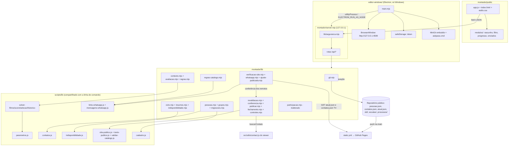
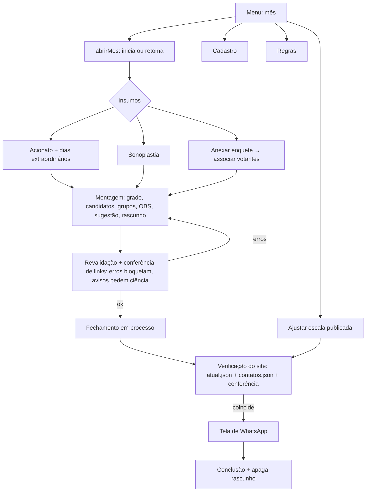
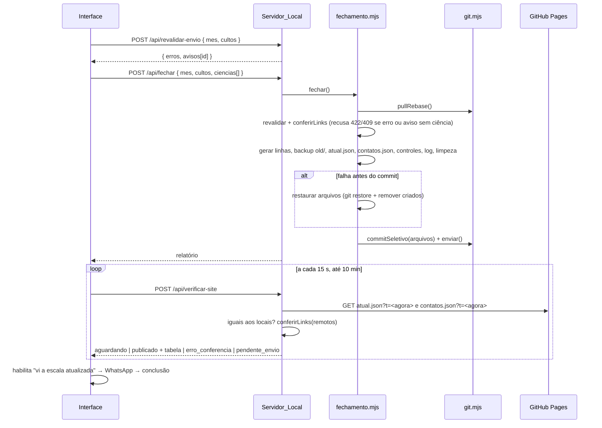
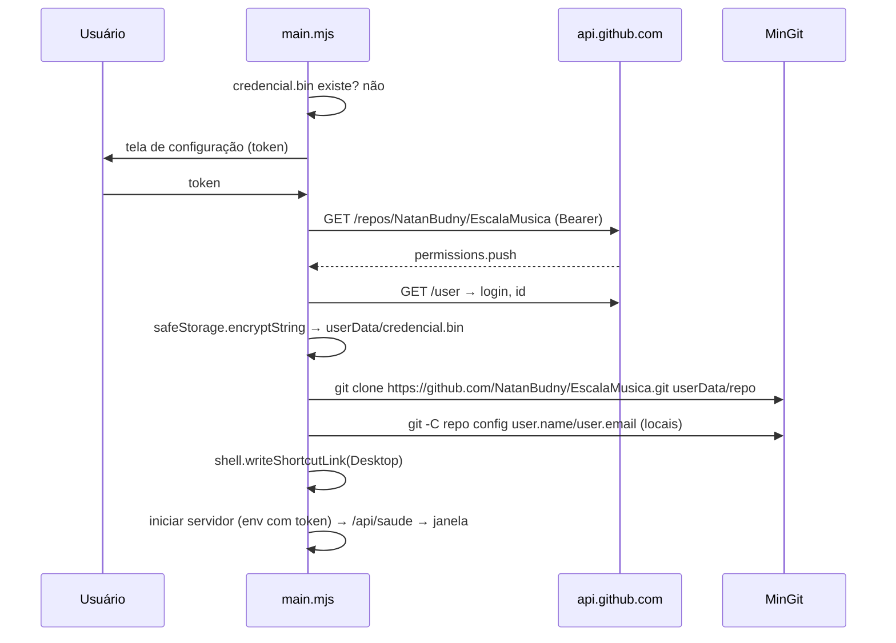

# Documento de Design: Melhoras Domingão

## Visão Geral

O editor de escala (`montador/`) passa a executar todo o ciclo mensal de `processos/guias/iniciar-escala-mensal.md` em processo, sem terminal: abrir o mês, digitar acionato e sonoplastia, importar a enquete, montar, revalidar, fechar (equivalente a `scripts/publicacao/publicar-fechamento.js`, sem shell e sem `scripts/local.py`), conferir o site, enviar WhatsApp e ajustar a escala publicada. Cadastro e regras ganham telas; as regras aplicadas pelo código passam a ler `processos/regras/parametros.json`, com valores iniciais que reproduzem o comportamento atual.

Toda gravação passa por `montador/lib/git.mjs`, que faz commit seletivo, `pull --rebase` e push sem force. O mesmo código roda em desenvolvimento (`npm run montar`) e dentro de uma casca Electron para Windows, que executa `montador/server.mjs` a partir de um clone do repositório público. Assim cada `git pull` atualiza código e dados ao mesmo tempo.

Ficam como estão: `desktop-app/`, `montador/lib/participacao.mjs` (o servidor adapta a entrada) e `html-revisao/` (só as regras por nome migram para o cadastro).

A escala online (`src/`) exibe nomes e OBS sem escape e resolve cada link com `buscarContato`, que devolve a primeira entrada do `contatos.json` cujo nome ou apelido normalizado coincide; EQUIPE LOUVOR e MENSAGEM MUSICAL passam por `formatarLista` (divide por vírgula) e os demais campos por `formatarNome` (valor inteiro). Por isso o editor publica exatamente `pessoa.nome` ou `grupo.nome_exibicao`, restringe os caracteres de nomes e OBS, e roda a mesma resolução do viewer sobre o `atual.json` e o `contatos.json` antes do fechamento e depois da publicação. Famílias e ministérios viram grupos escaláveis do cadastro, com o telefone do responsável no `contatos.json`.

## Arquitetura



**Convenções:**

- Toda função de `montador/lib/` que lê ou grava arquivos recebe `root` opcional (padrão `ROOT` de `montador/lib/regras.mjs`). Os testes usam pastas temporárias.
- Toda operação que grava devolve a lista de caminhos (relativos à raiz, com `/`) gravados ou removidos. Essa lista é o pathspec do commit seletivo.
- Lógica pura usada pelo navegador fica em `montador/public/modulos/*.js` (ESM sem DOM), porque o servidor só serve `montador/public/`. Esses módulos são testados em `tests/montador/`.
- `montador/server.mjs` passa a exportar `criarServidor({ root, porta, git })` e só chama `listen` quando executado diretamente. Isso permite testar as rotas.
- `scripts/*` que hoje rodam lógica no topo do arquivo (`gerar-contatos.js`, `gerar-links-publicacao.js`, `vincular-indisponibilidade.js`) passam a importar funções puras de `scripts/lib/`, com a mesma saída na linha de comando.

## Fluxo do ciclo mensal



### Sincronização (toda gravação)

```mermaid
sequenceDiagram
    participant UI as Interface
    participant S as Servidor_Local
    participant L as lib da operação
    participant G as git.mjs
    participant R as origin/main

    UI->>S: POST/PUT (Origin, content-type json)
    S->>L: executar operação
    L-->>S: { resultado, arquivos[] }
    S->>G: commitSeletivo(arquivos, mensagem)
    G->>G: git add -- <não rastreados>; git commit -m msg -- <arquivos>
    S->>G: enviar()
    G->>R: git pull --rebase --autostash
    alt conflito só em atual.json
        G->>G: checkout --theirs atual.json; add; rebase --continue (RF021)
    else outro conflito
        G->>G: rebase --abort → { push: 'conflito', conflitos }
    end
    G->>R: git push
    alt push falhou
        G-->>S: { push: 'pendente', erro }
    end
    S-->>UI: { resultado, git }
```

### Fechamento e verificação



### Primeira execução da casca



## Componentes e Interfaces

### A. Fundação

**`montador/lib/seguranca.mjs` (novo)**

```js
export const LIMITE_CORPO = 5 * 1024 * 1024;
/** Origens e hosts aceitos: 127.0.0.1:<porta> e localhost:<porta>. */
export function validarRequisicao({ method, headers }, porta)
  // → { ok: true } | { ok: false, status: 403 | 415, erro }
  // 403: Host fora da lista; método POST/PUT/DELETE sem Origin da lista.
  // 415: requisição com corpo e content-type ≠ application/json.
export function lerCorpoJson(req, limite = LIMITE_CORPO) // Promise<object>; rejeita com { status: 413 | 400 }
```

**`montador/server.mjs` (alterar)**

- `listen(porta, '127.0.0.1')`; abre o navegador em `http://127.0.0.1:<porta>/` salvo `MONTADOR_SEM_NAVEGADOR=1`.
- Na inicialização, salvo `MONTADOR_SEM_PULL=1`, chama `git.pullRebase()`. Se `codigoAlterado` e `MONTADOR_NA_CASCA=1`, encerra com código 75; senão, registra no console que é preciso reiniciar.
- `GET /api/saude` → `{ ok: true }`.
- `readBody` é substituído por `lerCorpoJson`; toda rota passa por `validarRequisicao`.

**`montador/lib/git.mjs` (novo)**

```js
/** @typedef {{ ok:boolean, semAlteracoes?:boolean, commit?:string, push?:'ok'|'pendente'|'conflito',
 *             conflitos?:string[], codigoAlterado?:boolean, erro?:string }} ResultadoGit */
export function criarGit({ cwd = ROOT, executavel = process.env.MONTADOR_GIT || 'git', env = process.env } = {}) {
  return {
    commitSeletivo(arquivos, mensagem),   // git add -- <não rastreados existentes>; git commit -m <msg> -- <arquivos>
    pullRebase(),                         // git pull --rebase --autostash + política RF021
    enviar(),                             // pullRebase() e, sem conflito, git push (nunca --force)
    status(),                             // { pendentes: rev-list --count @{u}..HEAD, ramo }
    autor(),                              // git config user.name || 'editor de escala'
  };
}
```

- Sempre `execFile(executavel, args, { cwd, env: { ...env, GIT_TERMINAL_PROMPT: '0' } })`. Nunca lança: erros viram `{ ok: false, erro }`.
- `commitSeletivo` ignora caminhos removidos que nunca foram rastreados. Se `git diff --quiet HEAD -- <arquivos>` e não há não rastreados, devolve `{ ok: true, semAlteracoes: true }`.
- Política de conflito em `pullRebase`: lista `git diff --name-only --diff-filter=U`. Se a lista é exatamente `['atual.json']`, executa `git checkout --theirs -- atual.json` (no rebase, *theirs* é o commit local reaplicado), `git add -- atual.json` e `git -c core.editor=true rebase --continue`. Caso contrário, `git rebase --abort` e devolve `conflitos`.
- `codigoAlterado` = algum caminho de `git diff --name-only <HEAD antes> HEAD` começa com `montador/` ou `scripts/`.
- `montador/lib/publicar.mjs` deixa de chamar git; quem comita é a rota, com a lista de arquivos devolvida.

**Rotas de sincronização:** `GET /api/sync/status` → `status()`; `POST /api/sync/tentar-de-novo` → `enviar()`.

### B. Cadastro

**`scripts/lib/contatos.js` (novo)** — `export function derivarContatos(pessoas, grupos = {})`: lógica atual de `scripts/manutencao/gerar-contatos.js` (só com telefone, `https://wa.me/<dígitos>`, `apelidos = aliases`, chaves ordenadas com `localeCompare('pt-BR', { sensitivity: 'base' })`), mais uma entrada `{ [nome_exibicao]: { telefone: <do responsável>, apelidos: [] } }` por Grupo_Escalavel cujo responsável tem telefone. O script passa a chamá-la com `arquivo.grupos`.

**`scripts/lib/texto-publico.js` (novo)** — regras do que o viewer exibe sem escape:

```js
export const CARACTERES_DE_NOME = /^[\p{L} .'-]+$/u;  // letras com acento, espaço, ponto, apóstrofo, hífen
export function problemasNome(texto)        // → string[]: vazio ou caractere fora de CARACTERES_DE_NOME (vírgula incluída)
export function problemasTextoLivre(texto)  // → string[]: '<' ou '>' (ANCIÃO, PREGADOR)
export function problemasObs(texto)         // → string[]: '<', '>' ou termo de scripts/lib/obs-publico.js
```

**`scripts/lib/cadastro.js` (alterar)** — `carregarPessoas` valida `precisa_de`: `com_ids` array não vazio de inteiros existentes, sem o próprio ID. Aceita `habilitacoes.sonoplastia` (booleano, padrão `false`). Valida cada grupo com `escalavel: true`: `responsavel_id` e `membros_ids` (não vazio) existentes, `modo ∈ { 'funcao', 'culto_inteiro' }` (padrão `funcao`), `funcoes ⊆ { 'regente', 'equipe', 'mm' }` (padrão `['mm']`), `mensagem` string opcional, `problemasNome(nome_exibicao)` vazio e `nome_exibicao` único após `normalizarNome` de `src/utils/name.js` entre nomes e apelidos de pessoas e `nome_exibicao` de outros grupos. Nomes e apelidos de pessoas fora dos Caracteres_de_Nome não reprovam o arquivo (o cadastro atual tem o apelido `FABRICIO 1`); eles aparecem como pendência na migração e são recusados ao salvar. Chaves desconhecidas no topo (`migracoes`) continuam ignoradas.

**`montador/lib/pessoas.mjs` (alterar)**

```js
export function validarTelefone(texto)                 // → { ok, digitos }  ok ⇔ '' ou /^55[1-9]{2}\d{8,9}$/
export function verificarPessoa(dados, id, { root })   // → { erros: string[], avisos: string[], telefoneCompartilhadoCom: string[] }
  // erros: duplicidade exata com pessoa ou nome_exibicao de grupo; problemasNome(nome/apelido) não vazio
  // avisos: duplicidade só após normalização (exige confirmarAvisos)
  // telefoneCompartilhadoCom: nomes de outras pessoas com o mesmo telefone (informativo, não exige confirmação)
export function listarPessoas({ root })                // → { pessoas, grupos, ultimaVez: { [id]: 'AAAA-MM-DD'|null }, migracoesPendentes: string[] }
export function salvarPessoa(dados, { id, confirmacaoTelefone, confirmarAvisos, root })  // → { pessoa, arquivos }
export function desativarPessoa(id, { root })           // → { pessoa, arquivos } (ativo=false, habilitações zeradas)
export function motivosBloqueioExclusao(id, { root })   // → string[] (vínculos, grupos, histórico)
export function excluirPessoa(id, { root })             // → { arquivos } ; lança se houver motivo
export function aplicarVinculos(arquivo, id, { sempreJunto, familiaRequerida, precisaDe, novoGrupo })
```

- `gravarValidado` passa a gravar `pessoas.json` e `contatos.json` (via `derivarContatos`) e devolver os dois caminhos. Backup continua em `montador/backups-pessoas/` (agora ignorado no git).
- `salvarPessoa` recusa telefone novo ou alterado quando `confirmacaoTelefone !== true` e recusa avisos de duplicidade não confirmados (`confirmarAvisos !== true`).
- `ultimaVez` varre `atual.json` e `old/AAAA/*.json` que sejam arrays (mesmo critério de `coletarPathsOld`), resolvendo nomes por nome/apelido normalizados.
- Mensagens de commit: `Cadastro: <criar|atualizar|desativar|excluir> <NOME> (editor de escala)`.
- `motivosBloqueioExclusao` inclui ser membro ou responsável de grupo.
- O formulário mostra `telefoneCompartilhadoCom` como aviso ("este número também é usado por BERNARDO") junto da confirmação do WhatsApp. Casos atuais: BERNARDO/RONI, MIRELLA/MARCELA/JULIANA ALVES, BETE/LUIZ DA SILVA, MIRIAN/STELLA, ADELAIDE/BANDA.

**`montador/lib/grupos.mjs` (novo)**

```js
export function gruposEscalaveis(arquivo)                // → Map<chave, GrupoEscalavel> com padrões aplicados
export function ocupanteDeGrupo(chave)                   // → 'grupo:<chave>' (formato usado em CultoMontagem e Rascunho)
export function salvarGrupo(chave, dados, { root })      // → { grupo, arquivos } via gravarValidado (pessoas.json + contatos.json)
export function removerGrupo(chave, { root })            // → { arquivos } ; grupo usado por familia_requerida é recusado pelo validador
```

Rotas `PUT /api/grupos/:chave` e `DELETE /api/grupos/:chave` (commit `Cadastro: <criar|atualizar|remover> grupo <NOME_EXIBICAO> (editor de escala)`). A tela "Grupos" do cadastro lista os grupos de `GET /api/pessoas` e edita membros, responsável, modo, funções e mensagem.

**`montador/lib/migracoes.mjs` (novo)** — migrações únicas, marcadas em `pessoas.json.migracoes`:

```js
export function diferencasContatos(contatosAtual, pessoasArquivo)
  // → [{ chave, tipo:'so_no_contatos'|'difere'|'so_no_gerado'|'coberto_por_grupo', proposta,
  //      pendencia?: { motivo:'telefone_compartilhado'|'caracteres', pessoas?, opcoes } }]
export function aplicarMigracaoContatos(pessoasArquivo, contatosAtual, decisoes) // lança se há pendência sem decisão ou se a migração de grupos não foi aplicada
                                                                               // → pessoasArquivo com migracoes.contatos_para_pessoas = 'AAAA-MM-DD'
export function propostaGrupos(pessoasArquivo)                      // → FAMILIA NILSINHO e MIN. JOVEM (membros editáveis pelo usuário)
export function aplicarMigracaoGrupos(pessoasArquivo, grupos)       // migracoes.grupos_escalaveis = 'AAAA-MM-DD'
export function migrarRegrasPorNome(pessoasArquivo)                 // idempotente; migracoes.regras_por_nome = 'AAAA-MM-DD'
```

- Entrada só no `contatos.json` cujo telefone é de uma ou mais pessoas: pendência `telefone_compartilhado` com as opções "apelido de <pessoa>" e "pessoa nova inativa com o mesmo telefone"; nunca vira apelido sem decisão (caso atual: `LAURA GESSNER`, com o telefone de `LAURA`). Sem pessoa de mesmo telefone, vira pessoa nova `ativo: false`, sem habilitações, com telefone e apelidos.
- Entrada cuja chave é `nome_exibicao` de Grupo_Escalavel: `coberto_por_grupo`, sem pessoa nem apelido (caso atual: `MIN. JOVEM`, que tem o telefone de FABRICIO). Por isso a migração de grupos vem antes da de contatos na tela.
- Nome ou apelido, no `contatos.json` ou no Cadastro, com `problemasNome` não vazio: pendência `caracteres` com "renomear" ou "remover" (caso atual: apelido `FABRICIO 1`).
- Grupos iniciais: `familia_nilsinho` = `{ escalavel: true, nome_exibicao: 'FAMILIA NILSINHO', membros_ids: [53, 32, 50, 45], responsavel_id: 53, modo: 'funcao', funcoes: ['mm'] }` (NILSINHO, JULIANA ALVES, MIRELLA, MARCELA); `min_jovem` = `{ escalavel: true, nome_exibicao: 'MIN. JOVEM', membros_ids: [21], responsavel_id: 21, modo: 'culto_inteiro' }` (FABRICIO; o usuário completa os membros). A tela mostra os membros para confirmar ou corrigir antes de aplicar.
- Regras por nome de `html-revisao/index.html`: ARIADNY recebe `dias_permitidos: ["sabado"]` (CATHERINE já tem); MANU C. `precisa_de [SILVANA]`; MANU S. `precisa_de [JESSICA, JOAS]`; MIRELLA e MARCELA `precisa_de [NILSINHO]` (NILSON é apelido de NILSINHO).
- Rotas: `GET /api/migracoes` e `POST /api/migracoes/:nome/aplicar` (corpo `{ decisoes }` na de contatos e `{ grupos }` na de grupos). A tela de cadastro mostra as pendentes antes da lista, na ordem grupos → contatos → regras por nome, com o botão "Aplicar" desabilitado enquanto há pendência sem decisão.

### C. Regras e parâmetros

**`scripts/lib/parametros.js` (novo)**

```js
export const PARAMETROS_PADRAO;                       // ver "Modelos de Dados"
export function carregarParametros(caminho)           // → { parametros, avisos } ; ausente/inválido → padrão + aviso
export function validarParametros(obj)                // → string[]
export function nivel(parametros, chave)              // → 'bloqueio' | 'aviso' | null (null = inativa)
export function evitarNaSugestao(parametros, chave)   // → ativa && (nivel === 'bloqueio' || evitar_na_sugestao)
```

**Solver (alterar)** — todos leem `contexto.parametros` (padrão `PARAMETROS_PADRAO` quando ausente):

| Arquivo | Mudança | Com os padrões |
|---|---|---|
| `solver-filtros.js` | Filtros 5–6 dependem de `evitarNaSugestao('indisponibilidade')`; filtro 7 de `conflito_sonoplastia` e `conflito_pregador`; filtro 8 consulta `contexto.papeisPorCulto` (Map data → Map id → Set slot) para aplicar `conflito_regencia`, `repeticao_no_culto` e `equipe_e_mm_mesmo_culto`. `dias_permitidos` compara o dia real da data, normalizando `quarta`/`quarta-feira`. | Mesma exclusão de hoje |
| `solver-score.js` | `PESOS` e a janela de 120 dias vêm de `parametros.score`. | Mesmos números |
| `solver-selecao.js` | `TAMANHO_EQUIPE` de `parametros.equipe.tamanho`; quantidade de MM pelo `culto.modelo_louvor` (fallback `dia_semana`) e por `mm_sabado.valores.quantidade`; `marcarEscalado` também alimenta `papeisPorCulto`; aceita `culto.fixos` (já marcados no contexto) e só preenche o que falta. | Sem fixos, mesma sequência de escolhas |
| `solver-historico.js` | Sem mudança de assinatura; quem chama passa `parametros.historico.janela_meses`. | 4 meses |
| `scripts/ciclo/sugerir-rascunho.js` | Carrega `processos/regras/parametros.json`, passa `contexto.parametros` e a janela; ganha `--root=<pasta>` para o teste de regressão. | Mesmo `rascunho.md` |

**`montador/lib/regras-catalogo.mjs` (novo)**

```js
export function listarCatalogo({ root })       // → EntradaCatalogo[]
export function historico(id, { root })        // → Versao[]
export function editarTexto(id, textos, { autor, root })     // → { versao, arquivos }
export function reverter(id, numero, { autor, root })        // → { versao, arquivos }
export function salvarParametros(novo, { autor, root })      // → { versao, arquivos } ; recusa se validarParametros ≠ []
export function salvarMensagens(novo, { autor, root })       // → { versao, arquivos } ; recusa se validarMensagens ≠ [] (ver F)
export function validarCatalogo({ root })      // → { erros, avisos } via scripts/lib/validar-catalogo.js
```

- `EntradaCatalogo = { id, categoria, arquivo, textos: { [campo]: string }, extras, parametros: string[] }`. Origem por categoria: `fundamentais.json` e `preferencias.json` (arrays, por `id`), `restricoes-pessoais.json` (objeto nome → array, por `id`), `papeis.json` (objeto, id = nome do papel), `glossario.json` (objeto, id = termo, texto = valor).
- Campos de texto editáveis: os campos string da entrada exceto `id` (`descricao`, `detalhe`, `excecao`, `nota`, ou o valor do termo no glossário).
- `scripts/lib/validar-catalogo.js` (novo) extrai as checagens de `scripts/validacao/validar-regras.js` (que passa a usá-lo) e acrescenta a integridade dos arquivos canônicos: JSON válido, `id` e `descricao` presentes, IDs únicos. `REGRAS.md` e `regras.snapshot.json` continuam como documentação de compatibilidade listada em `regras.index.json`.
- Rotas: `GET /api/regras`, `GET /api/regras/:id/historico`, `PUT /api/regras/:id/texto`, `POST /api/regras/:id/reverter`, `GET /api/parametros`, `PUT /api/parametros`, `GET /api/mensagens-whatsapp`, `PUT /api/mensagens-whatsapp`.
- As Mensagens_WhatsApp têm card próprio na tela de regras (templates, contatos fixos, link do grupo, histórico e reverter), versionadas no Historico_de_Versoes com `alvo: 'mensagens-whatsapp'`, `tipo: 'mensagens'`.

### D. Mês e insumos

**`montador/lib/ciclo.mjs` (novo)**

```js
export function calendarioBase(mes)          // → ItemAcionato[] com todas as quartas, sábados e domingos
export function abrirMes(mes, { root })      // → { iniciadoAgora, arquivos, insumos: { acionato, sonoplastia, enquete }, publicado }
```

Cria `escalas/AAAA/MM/insumos/` e `arquivo/` como `scripts/ciclo/iniciar-mes.js`, mas o Acionato traz o calendário completo (o script continua gerando só sábados). Mês já iniciado: nada é sobrescrito. `insumos.*` ∈ `'preenchido' | 'pendente'`; `publicado` = `atual.json` contém o mês.

**`montador/lib/insumos.mjs` (novo)**

```js
export function lerAcionato(mes, { root })                 // itens com modelo_louvor/extraordinario normalizados
export function validarAcionato(mes, acionato)             // → string[]: data no mês, datas únicas, modelo válido
export function salvarAcionato(mes, acionato, { root })    // → { arquivos }
export function lerSonoplastia(mes, { root })
export function validarSonoplastia(mes, sonoplastia, cadastro) // → string[]: ID existente com habilitação sonoplastia, ou texto livre com problemasNome vazio
export function salvarSonoplastia(mes, sonoplastia, { root })  // → { arquivos }
```

A tela de sonoplastia lista todos os cultos do mês (inclusive quartas), com "Sonoplasta" e "Suporte" (opcional) escolhidos entre pessoas ativas com `habilitacoes.sonoplastia`, ou texto livre marcado "fora do cadastro" (ex.: "VOLUNTÁRIO"). O atalho "cadastrar pessoa" abre o formulário de pessoa com a habilitação marcada e volta à tela.

**`montador/lib/regras.mjs` → `cultosDoMes` (alterar)** — mantém a prioridade atual (Acionato quando existe, senão calendário) e acrescenta: `modelo_louvor` (padrão pelo dia: sábado → `sabado`, domingo → `domingo`, quarta → `sem_louvor`), `extraordinario`, `obs` (valor inicial da Observação do card, de `observacoes`), `audiovisual` = `sonoplastia[0]` (fallback `item.audiovisual`), `suporte` = `sonoplastia[1]` ou "-", e `sonoplastiaIds` = `ids` não nulos. Em `externosPorCulto`, item sem `ids` (arquivo antigo) tem cada nome resolvido por nome/apelido; texto livre não gera conflito.

**`scripts/lib/indisponibilidade.js` (novo)**

```js
export function nomesDaEnquete(enquete)                                  // indisponiveis + indisponiveis_tempo_indeterminado
export function montarVinculada(enquete, cadastro, mapeamentos, { fonte, agora })
  // mapeamentos: Map<nomeEnquete, pessoaId>; propaga sempre_junto; 'geral' → indisponiveis_mes_inteiro
  // saída idêntica à de scripts/ciclo/vincular-indisponibilidade.js, que passa a usá-la
```

**`montador/lib/indisponibilidade.mjs` (novo)**

```js
export function validarEnquete(obj, mes)          // → { erros, datasIgnoradas }
export function analisarEnquete(enquete, cadastro) // → Associacao[]
export function gravarImportacao(mes, enquete, decisoes, { root, hoje })
  // → { relatorio: { associados, pendentes, ignorados }, arquivos, apelidosNovos: [{ pessoaId, apelido }] }
```

`Associacao = { nomeEnquete, estado: 'associado'|'pendente'|'ignorado', por: 'telefone'|'nome'|'usuario'|null, pessoaId, opcoes: [{ id, nome, confianca }] }`. Algoritmo em "Algoritmos principais". Rotas: `POST /api/mes/:mes/indisponibilidade/analisar` e `POST /api/mes/:mes/indisponibilidade/gravar`. Apelidos novos são gravados com `salvarPessoa` (commit do cadastro) e os três arquivos do mês em outro commit. Decisão do usuário sobre texto com `problemasNome` não vazio (por exemplo, um número de telefone compartilhado) vale só para a importação atual e não vira apelido.

### E. Montagem

**`montador/lib/contexto.mjs` (novo)** — fonte única das regras de contexto (RF005, RF015, "-"/vazio):

```js
export const DEPARTAMENTOS;                         // movido de regras.mjs (reexportado lá)
export function ehDepartamental(nome)
export function tipoDoCulto(culto)                  // 'louvor' | 'quarta' | 'departamental' | 'sem_louvor'
export function tipoDaLinhaAtual(linha)             // mesmo enum para linhas de atual.json
export function slotsDoCulto(culto, parametros)     // sabado → ['regente','equipe','mm_es','mm_culto'] (mm_es some se mm_sabado.quantidade = 1)
                                                    // domingo → ['regente','equipe','mm_domingo']; demais tipos → []
export function nomesParticipantes(valor)          // divide por vírgula; ignora '', '-', DEPARTAMENTOS (nome_exibicao de grupo conta como participante)
export function paraParticipacao(cultos, cadastro) // adapta para resumoParticipacao: nomes e dia_semana = modelo_louvor
export function ehOcupanteGrupo(ocupante)          // ocupante = id numérico de pessoa | 'grupo:<chave>'
```

`tipoDoCulto`: `quarta-feira` → `quarta`; pregador departamental → `departamental`; `modelo_louvor === 'sem_louvor'` → `sem_louvor`; senão `louvor`.

**`montador/lib/avaliacao.mjs` (novo)** — avaliação única usada por candidatos, substitutos, validação e revalidação:

```js
export function criarEstadoMes(base, cultos)       // ids por culto/slot, papéis, MM por pessoa, culto anterior com louvor
export function avaliarAtribuicao(base, estado, data, slot, ocupante)  // ocupante = pessoaId | 'grupo:<chave>' → { bloqueios: Motivo[], avisos: Motivo[] }
export function avaliarCulto(base, estado, data)   // → Motivo[]: minimo_homens, equipe_incompleta, regente_vazio, mm_vazia, excedente
/** Motivo = { chave, refs, nivel: 'bloqueio'|'aviso', texto } */
```

- Grupo_Escalavel (algoritmo em "Algoritmos principais"): `funcoes` no lugar de habilitação; indisponível só se nenhum membro está disponível; aviso fixo `membros_indisponiveis` com os nomes; aviso fixo `membro_em_outra_funcao` quando um membro ocupa outra função do culto (e, para uma pessoa, quando ela é membro de grupo já escalado no culto); MM por mês e consecutivo contados pela chave do grupo.
- Culto com `assumidoPor`: `avaliarCulto` dispensa `minimo_homens`, `equipe_incompleta`, `regente_vazio` e `mm_vazia`; o grupo é avaliado uma vez, como ocupante de todas as funções.
- `excedente`: aviso fixo por nome de `culto.excedentes` (nomes lidos de `atual.json` além das vagas do modelo).

**`montador/lib/regras.mjs` (alterar)**

```js
export function carregarContexto(mes, { root = ROOT } = {})  // + parametros, avisosParametros, acionato, sonoplastia, publicada
export function candidatosParaCelula(base, cultos, data, slot)            // → { elegiveis, elegiveisComAviso, naoElegiveis }
export function candidatosSubstitutos(base, cultos, data, slot, pessoaId) // idem, sem a pessoa substituída
export function sugerirMes(base, { cultos = [], modo = 'tudo' } = {})     // → CultoMontagem[]
export function validarEscala(base, cultos)                               // → { erros: ItemValidacao[], avisos: ItemValidacao[] }
```

- `candidatosParaCelula`: para cada pessoa ativa habilitada no slot e cada Grupo_Escalavel com o slot em `funcoes`, `avaliarAtribuicao`; sem bloqueio e sem aviso → `elegiveis` (pessoas na ordem de `sortByScore` com `escaladosNesteMes`, `escaladosPorCulto` e `dataAnterior` construídos da escala do mês; grupos ao fim da seção); só avisos → `elegiveisComAviso`; com bloqueio → `naoElegiveis` com `motivoBloqueio` = texto do primeiro bloqueio. Cada item traz `tipo: 'pessoa' | 'grupo'`.
- `sugerirMes`: percorre os cultos do Acionato (inclusive extraordinários) em ordem de data, passando `dia_semana: modelo_louvor` ao `sugerirCulto`. O Solver só recebe pessoas, então nunca escala grupo. `modo: 'vazios'` pré-carrega todas as atribuições existentes no contexto e as envia como `culto.fixos`; grupo fixo ocupa a vaga e seus membros entram em `escaladosPorCulto` daquele culto; culto com `assumidoPor` fica inteiro fora da sugestão.
- `validarEscala`: cada atribuição passa por `avaliarAtribuicao` e cada culto por `avaliarCulto`; nome ou ID fora do Cadastro é erro. Mensagens mantêm o formato atual (`DD/MM/AAAA: ...`).
- Rotas: `GET /api/dados?mes=` passa a devolver `cultos` com `tipo`, `slots`, `modelo_louvor`, acionato e sonoplastia, além de `publicada` (atribuições do mês em `atual.json` por ID, ou `null`); `POST /api/candidatos` e `POST /api/substitutos` recebem `{ mes, cultos, data, slot, pessoaId? }`; `POST /api/sugerir` recebe `{ mes, cultos, modo }`; `POST /api/participacao` aplica `paraParticipacao` antes de `resumoParticipacao`.

**`montador/public/modulos/` (novo, ESM puro)**

```js
// rascunho.js
export const chaveRascunho = (mes) => `escala:rascunho:${mes}`;
export function serializarRascunho(mes, cultos)            // → string (versão 1, só IDs de pessoa e 'grupo:<chave>', acomp, obs, assumidoPor, excedentes)
export function desserializarRascunho(texto, pessoasPorId, gruposPorChave) // → { cultos, foraDoCadastro: [{ data, slot, id }] }
export function assinatura(cultos)                         // string canônica: cultos de louvor (data, acomp, regente, equipe, mm, assumidoPor) + OBS de todos os cultos
// filtro.js
export function datasVisiveis(cultos, filtro)              // filtro = { dias: Set, data?, extraordinarios? } → Set<data>
export function filtrarPessoas(pessoas, busca, filtros)    // busca por nome/apelido + função (inclui sonoplastia), situação, afastado, dias, perfil
// progresso.js
export function calcularProgresso(cultos)                  // → { preenchidas, pendentes, total, completos: Set<data> } ; culto com assumidoPor = completo
// enviados.js
export const chaveEnviados = (mes) => `escala:whatsapp:${mes}`;
export function marcarEnviado(enviados, chave)             // → novo Set (idempotente)
export function separar(envios, enviados)                  // → { pendentes, enviados }
```

**`montador/public/{index.html, app.js, estilo.css}` (alterar)**

- Menu: mês, "Montar escala", "Gerenciar pessoas", "Regras", "Ajustar escala publicada".
- Abrir mês: checklist de insumos (acionato, sonoplastia, enquete) com telas próprias; depois a montagem.
- Grade: `grid-template-columns: repeat(4, minmax(0, 1fr))`, com media queries para 3 e 2 colunas considerando o painel lateral de 300px; classe `sabado` nos cards de modelo sábado; card mostra ancião, pregador, sonoplasta e suporte, `<select>` Banda/PB e o campo "Observação".
- Observação: `<textarea>` pré-preenchido com `obs` do Acionato, placeholder "Este texto será publicado na escala online" (o mesmo do campo de observações do acionato e da OBS em "Ajustar escala publicada"). A cada digitação, com atraso de 300 ms, chama `POST /api/texto-publico { tipo: 'obs', texto }` e mostra no card os problemas de `problemasObs`.
- Estado em `estado.cultos` com IDs (`CultoMontagem`); nomes vêm de `pessoasPorId` e `gruposPorChave`. Cada mudança chama `salvarRascunho()` e recalcula progresso e indicador.
- Seletor: três seções (elegíveis, com aviso, não elegíveis recolhidos); grupos aparecem com o rótulo "grupo". Clique num chip abre substitutos.
- Card de culto `louvor` mostra "Grupo assume o culto" quando há Grupo_Escalavel `culto_inteiro`; a ação grava `assumidoPor` e exibe o grupo no lugar de regente, equipe e MM (desfazer limpa `assumidoPor`).
- Excedentes lidos de `atual.json` aparecem no card com "remover" e "mover para vaga".
- Sugestão: modal com "Sobrescrever tudo", "Só preencher vazios" e "Cancelar" quando há atribuição.
- Envio: painel de revalidação com caixas de ciência por aviso e os erros da conferência de links (culto, campo, nome, número que o link abre); botão "Enviar" habilitado só sem erros e com todas as ciências.

### F. Envio

**`montador/lib/revalidacao.mjs` (novo)**

```js
export function revalidarParaEnvio(base, cultos)  // → { erros, avisos, linhasAtual, contatos, conferencia }
export function travaTelefone(linhasAtual, cadastro) // → ItemValidacao[]: pessoa sem telefone ou Grupo_Escalavel cujo responsável não tem telefone;
                                                     //   só Departamento é isento; cada nome de campo com vírgula avaliado separadamente
export function verificarObs(linhasAtual)            // → ItemValidacao[] (problemasObs de scripts/lib/texto-publico.js)
```

Junta `validarEscala`, `travaTelefone`, `verificarObs`, `validarCatalogo`, `conferirLinks(linhasAtual, derivarContatos(pessoas, grupos), base)` e um aviso por votante pendente da Enquete. `scripts/lib/obs-publico.js` (criado com o campo Observação da montagem) exporta a lista de termos de `scripts/validacao/validar-obs-publico.js`, que passa a importá-la. O prefixo `PUBLICAR:` exigido pelo script não é exigido no editor: a OBS vem do campo "Observação" do card (RF016) e o viewer exibe OBS literalmente (o `atual.json` de agosto/2026 não usa o prefixo). `POST /api/texto-publico { tipo: 'obs'|'nome'|'livre', texto }` → `{ problemas }` expõe as mesmas funções à interface.

**`montador/lib/conferencia.mjs` (novo)** — Conferencia_de_Links com o código do viewer:

```js
import { buscarContato } from '../../src/utils/contact.js';
export const CAMPOS_LISTA = ['EQUIPE LOUVOR', 'MENSAGEM MUSICAL'];                          // viewer usa formatarLista
export const CAMPOS_NOME  = ['REGENTE LOUVOR', 'AUDIOVISUAL', 'SUPORTE', 'ANCIÃO', 'PREGADOR']; // viewer usa formatarNome
export function nomesComoOViewer(campo, valor)      // CAMPOS_LISTA: valor.split(',').map(trim); CAMPOS_NOME: [valor]; ignora '' e '-'
export function entradasQueCasam(contatos, nome)    // chaves cujo nome ou apelido normalizado (normalizarNome de src/utils/name.js) = nome
export function conferirLinks(linhas, contatos, base)
  // → { erros: ItemValidacao[], tabela: [{ data, campo, nome, numero: string|null }] } ; algoritmo em "Algoritmos principais"
```

A designação de cada campo vem do Cadastro pelo nome publicado, que é exatamente `pessoa.nome` ou `nome_exibicao` (Requisito 22.1): louvor → pessoa ou responsável do grupo; AUDIOVISUAL/SUPORTE → pessoa do Cadastro de mesmo nome, ou "sem link" para texto fora do cadastro; ANCIÃO/PREGADOR → pessoa do Cadastro de mesmo nome normalizado, se existir (senão só ambiguidade e caracteres são conferidos). Como a função só depende dos arquivos e do Cadastro, a mesma chamada serve ao fechamento, ao ajuste e à verificação dos arquivos remotos.

**`montador/lib/publicar.mjs` (alterar)**

```js
export function gerarLinhasAtual(base, cultos) // → LinhaAtual[] em ordem de data, chaves = CAMPOS_ATUAL
export function cultosDeAtual(linhas, base)    // → CultoMontagem[] (nomes → IDs; preserva LOUVORES ES, TEMA CULTO, SUPORTE)
export function backupAtual({ root })          // → caminho criado em old/AAAA/MMAAAA.json ou null
```

`cultoParaAtual` usa `tipoDoCulto`: `quarta`/`sem_louvor` → "-" nos campos de louvor; `departamental` → nome do Departamento; `louvor` → `pessoa.nome` por ID e `nome_exibicao` para `'grupo:<chave>'`, MM na ordem `mm_es, mm_culto` (RF012) unida por ", " e, com uma vaga vazia, só a preenchida; `assumidoPor` → `nome_exibicao` em REGENTE LOUVOR, EQUIPE LOUVOR e MENSAGEM MUSICAL (como "MIN. JOVEM" em 23/08/2026). OBS = `culto.obs`; AUDIOVISUAL = sonoplasta; SUPORTE = suporte ou "-". ACOMP vem do culto. Campos que o editor não edita são preservados de `atual.json` quando a data já existe nele.

`cultosDeAtual` resolve cada nome por `pessoa.nome`/apelido normalizado ou `nome_exibicao`; MENSAGEM MUSICAL do modelo sábado: 1º nome → `mm_es`, 2º → `mm_culto` (`"DANI HERREIRA, BERNARDO"` em 08/08/2026); domingo: 1º → `mm_domingo`; os três campos iguais ao `nome_exibicao` de grupo `culto_inteiro` → `assumidoPor`; nomes além das vagas do modelo vão para `culto.excedentes` (nunca descartados); nomes não resolvidos continuam "fora do cadastro".

**`montador/lib/controles.mjs` (novo) + `scripts/controle/controle-rotacao-utils.js` (alterar)**

- As três funções `gerarControle*` aceitam `{ periodos, saida, root }`, com os valores atuais como padrão (os scripts `controle:*` não mudam). `IGNORAR` passa a incluir `DEPARTAMENTOS`. Grupo_Escalavel é contado pelo `nome_exibicao`, como o controle de MM já faz hoje com "FAMILIA NILSINHO".
- `periodosDaJanela(mes, janelaMeses, { root })`: arquivos `old/AAAA/MM-AAAA.json` ou `old/AAAA/MMAAAA.json` dos meses da janela anteriores ao mês publicado, mais `atual.json`.
- `atualizarControles(mes, { root, parametros })` → `{ arquivos }` gravando `escalas/AAAA/MM/controle-{mensagem-musical,regentes,equipe-louvor}.json`.

**`montador/lib/fechamento.mjs` (novo)**

```js
export async function fechar({ mes, cultos, ciencias }, { root, git, agora = new Date() })
  // → RelatorioFechamento | lança ErroFechamento({ status: 409|422, erros, avisosSemCiencia })
```

Etapas em "Algoritmos principais". Rota `POST /api/fechar` (substitui `POST /api/publicar`).

**`montador/lib/verificacao-site.mjs` (novo)**

```js
export const URL_ATUAL = 'https://natanbudny.github.io/EscalaMusica/atual.json';
export const URL_CONTATOS = 'https://natanbudny.github.io/EscalaMusica/contatos.json';
export function conteudoCoincide(textoRemoto, textoLocal) // JSON.parse dos dois e igualdade profunda; JSON inválido → false
export async function conferirSite({ root, git, fetch = globalThis.fetch, agora = Date.now })
  // → { estado: 'pendente_envio' | 'aguardando' | 'publicado' | 'erro_conferencia' | 'erro_rede',
  //     url: 'https://natanbudny.github.io/EscalaMusica/', tabela?, erros? }
```

`pendente_envio` quando `git.status().pendentes > 0`; senão busca `URL_ATUAL` e `URL_CONTATOS` com `'?t=' + agora()` e `{ cache: 'no-store' }`. Algum diferente do local → `aguardando`. Os dois iguais → `conferirLinks` sobre os textos remotos: sem erro → `publicado` com a `tabela` (nome na escala → número que o link abre, só REGENTE LOUVOR, EQUIPE LOUVOR e MENSAGEM MUSICAL); com erro → `erro_conferencia` com `erros`. A interface repete `POST /api/verificar-site` a cada 15 s por até 10 min e depois oferece "continuar verificando"; o botão "vi a escala atualizada" só habilita em `publicado`.

**`scripts/lib/mensagens-whatsapp.js` (novo)**

```js
export const MENSAGENS_PADRAO;                         // conteúdo inicial de mensagens-whatsapp.json (ver "Modelos de Dados")
export const PLACEHOLDERS = ['{nome}', '{mes/ano}', '{funções}', '{data}', '{grupo}'];
export function carregarMensagens(caminho)             // → { mensagens, avisos } ; ausente/inválido → MENSAGENS_PADRAO + aviso
export function validarMensagens(obj)                  // → string[]: template vazio, placeholder fora de PLACEHOLDERS, fixo sem nome, link inválido
export function preencherMensagem(template, { nome, mesAno, funcoes, datas, grupo })
  // {nome} → formato título ("DANY KALLAS" → "Dany Kallas"); {mes/ano} → "agosto/2026";
  // {funções} → "*REGENTE LOUVOR*, *EQUIPE LOUVOR* e *MENSAGEM MUSICAL*"; {data} → "23/08" (várias: vírgula e " e "); {grupo} → nome_exibicao
```

**`scripts/lib/links-whatsapp.js` (novo) + `montador/lib/whatsapp.mjs` (novo)**

- A lib exporta `normalizeNome`, `parseCelulaNomes`, `montarLink` e `montarListaEnvios(escala, contatos, { mensagens, grupos, ehIsento })`, extraídos de `scripts/publicacao/gerar-links-publicacao.js`; o texto passa a vir de `carregarMensagens('processos/regras/mensagens-whatsapp.json')` em vez do `MENSAGEM_TEMPLATE` fixo. O script passa a usá-los e continua gravando o `.md`.
- Pessoa: um envio com o template `pessoa` e as funções que ela ocupa no mês. Grupo_Escalavel: um envio para o telefone do responsável, com `{nome}` = nome do responsável, `grupo.mensagem` se preenchida ou o template `grupo` (`funcao`) ou `culto_inteiro` (com `{data}` dos cultos assumidos). Membros do grupo não recebem envio pelo grupo. Fixos: template `fixo`, telefone pelos Contatos_Derivados.
- `listaDoMes({ root })` → `{ mesAno, envios: Envio[], semContato, avisos }`, com `Envio = { chave, tipo: 'pessoa'|'grupo'|'fixo'|'convite', nome, funcoes, link }`. Usa `atual.json`, `derivarContatos(pessoas, grupos)` e as Mensagens_WhatsApp em memória; isenta só cultos `departamental` (`tipoDaLinhaAtual`, `nomesParticipantes`). Não grava arquivo. Rota `GET /api/whatsapp`.
- Texto novo de RF025 gravado por `editarTexto('RF025', ...)`: o template oficial fica em `processos/regras/mensagens-whatsapp.json`, editado na tela de regras.
- Texto novo de RF023 gravado por `editarTexto('RF023', ...)`: a tela de WhatsApp do editor é etapa obrigatória do fechamento; cada contato é marcado como enviado na tela; `links-whatsapp.md` é gerado só pelo script de linha de comando.

**`montador/lib/ajuste-publicada.mjs` (novo)**

```js
export function listarPublicada({ root })                            // → { mes, linhas }
export function previsaoAjuste({ data, campo, valor }, { root })     // → { erros, avisos }
export async function ajustar({ data, campo, valor, ciencias }, { root, git })  // → { relatorio, git }
```

`campo ∈ { 'REGENTE LOUVOR', 'EQUIPE LOUVOR', 'MENSAGEM MUSICAL', 'OBS', 'ACOMP' }`; para campos de nome, `valor` é lista de ocupantes (IDs de pessoa ou `'grupo:<chave>'`); a OBS usa o placeholder "Este texto será publicado na escala online". A revalidação usa `cultosDeAtual` + `validarEscala` restrita ao culto (e checagens do mês como MM por mês), `travaTelefone`, `verificarObs` e `conferirLinks`. A indisponibilidade é recalculada em memória de `insumos/indisponibilidade-cantores.json` (preservado pela limpeza) com as associações automáticas; votantes sem associação geram aviso. Grava só o campo, atualiza os controles, comita `atual.json` e os controles, envia. Rotas: `GET /api/publicada`, `POST /api/publicada/previa`, `PUT /api/publicada`.

### G. Casca e instalador (`editor-windows/`)

| Arquivo | Responsabilidade |
|---|---|
| `package.json` | `electron` e `electron-builder` em devDependencies; `"type": "module"`; `main: main.mjs` |
| `main.mjs` | instância única; primeira execução; inicia servidor; janela; links externos; `--smoke` |
| `lib/servidor.mjs` | `montarEnvServidor({ porta, mingitDir, askpass, token })`; `decidirReinicio(codigo, jaReiniciou)`; espera `/api/saude` |
| `lib/links.mjs` | `linkPermitido(url)` com prefixos `https://wa.me/`, `https://chat.whatsapp.com/`, `https://natanbudny.github.io/EscalaMusica/` |
| `lib/primeira-execucao.mjs` | `validarToken(token, fetch)` → `{ ok, login, id, motivo }`; `clonar`; `configurarIdentidade` |
| `preload.cjs` + `configuracao.html` | tela de token via `contextBridge` (`contextIsolation: true`, `sandbox: true`, sem `nodeIntegration`) |
| `askpass.cmd` | responde `x-access-token` quando o prompt contém "Username" e `%ESCALA_GIT_TOKEN%` nos demais |
| `mingit.json` + `scripts/baixar-mingit.mjs` | versão fixa, URL oficial do Git for Windows e SHA-256 conferido antes de extrair em `vendor/mingit` |
| `electron-builder.yml` | alvo `nsis` x64; `extraResources`: `vendor/mingit`, `askpass.cmd` |
| `README.md` | instalação, token, alerta do SmartScreen ("Mais informações" > "Executar assim mesmo") |

- Servidor: `utilityProcess.fork(<clone>/montador/server.mjs, [], { cwd: <clone>, env })`; se indisponível, `spawn(process.execPath, [server.mjs], { env: { ...env, ELECTRON_RUN_AS_NODE: '1' } })`.
- `env` do servidor: `MONTADOR_PORT=4599`, `MONTADOR_SEM_NAVEGADOR=1`, `MONTADOR_NA_CASCA=1`, `MONTADOR_GIT=<mingit>/cmd/git.exe`, `GIT_ASKPASS=<resources>/askpass.cmd`, `ESCALA_GIT_TOKEN=<token>`, `GIT_CONFIG_COUNT=1`, `GIT_CONFIG_KEY_0=credential.helper`, `GIT_CONFIG_VALUE_0=` (desliga o gerenciador de credenciais sem alterar arquivos de configuração).
- Porta fixa 4599 mantém a mesma origem e, com ela, o `localStorage` (Rascunho e enviados).
- Janela: `setWindowOpenHandler` e `will-navigate` só deixam a janela em `http://127.0.0.1:4599`; links permitidos vão para `shell.openExternal`, demais são bloqueados.
- Pastas: `userData/credencial.bin` (token cifrado), `userData/repo` (Clone_Local). `ESCALA_REPO_DIR` substitui o clone no smoke test.
- `--smoke`: pula a primeira execução, usa `ESCALA_REPO_DIR`, inicia o servidor com `MONTADOR_SEM_PULL=1`, exige 200 em `/api/saude` e em `/`, roda `git --version` do MinGit e sai com 0 (ou 1 após 60 s).

**`.github/workflows/editor-windows.yml` (novo)** — gatilhos: tags `editor-v*`, `workflow_dispatch` e PRs que tocam `editor-windows/**` ou `montador/**`. Job em `windows-latest`: checkout, Node 20, `npm ci` na raiz e `npm test`, `npm ci` em `editor-windows`, `node scripts/baixar-mingit.mjs`, `npx electron-builder --win nsis --publish never`, smoke (`win-unpacked/<app>.exe --smoke` com `ESCALA_REPO_DIR=${{ github.workspace }}`), upload do instalador; em tag, release com a nota do SmartScreen. Smoke falho encerra antes do upload.

## API do Servidor_Local

Todas as rotas passam por `validarRequisicao`. Gravações respondem `{ ..., git: ResultadoGit }`.

| Método e rota | Corpo / parâmetros | Resposta |
|---|---|---|
| `GET /api/saude` | — | `{ ok: true }` |
| `GET /api/sync/status` · `POST /api/sync/tentar-de-novo` | — | `{ pendentes, ramo }` · `ResultadoGit` |
| `GET /api/pessoas` | — | `{ pessoas, grupos, ultimaVez, migracoesPendentes }` |
| `POST /api/pessoas/verificar` | `{ dados, id? }` | `{ erros, avisos, telefoneCompartilhadoCom }` |
| `POST /api/pessoas` · `PUT /api/pessoas/:id` | `{ dados, confirmacaoTelefone, confirmarAvisos }` | `{ pessoa, git }` / 422 |
| `POST /api/pessoas/:id/desativar` · `DELETE /api/pessoas/:id` | — | `{ pessoa?, git }` / 422 com motivos |
| `PUT /api/grupos/:chave` · `DELETE /api/grupos/:chave` | `GrupoEscalavel` · — | `{ grupo?, git }` / 422 com a mensagem do validador |
| `GET /api/migracoes` · `POST /api/migracoes/:nome/aplicar` | — · `{ decisoes?, grupos? }` | `{ pendentes, diferencas, propostaGrupos }` · `{ git }` / 422 com pendências |
| `GET /api/regras` · `GET /api/regras/:id/historico` | — | `EntradaCatalogo[]` · `Versao[]` |
| `PUT /api/regras/:id/texto` · `POST /api/regras/:id/reverter` | `{ textos }` · `{ numero }` | `{ versao, git }` |
| `GET /api/parametros` · `PUT /api/parametros` | `Parametros` | `{ parametros, avisos }` · `{ versao, git }` |
| `GET /api/mensagens-whatsapp` · `PUT /api/mensagens-whatsapp` | `MensagensWhatsApp` | `{ mensagens, avisos }` · `{ versao, git }` / 422 |
| `POST /api/texto-publico` | `{ tipo: 'obs'\|'nome'\|'livre', texto }` | `{ problemas }` |
| `POST /api/mes/:mes/abrir` | — | resultado de `abrirMes` + `git` |
| `GET`/`PUT /api/mes/:mes/acionato` · `GET`/`PUT /api/mes/:mes/sonoplastia` | arquivo do insumo | insumo · `{ git }` / 422 |
| `POST /api/mes/:mes/indisponibilidade/analisar` | `{ enquete }` | `{ erros, datasIgnoradas, associacoes }` |
| `POST /api/mes/:mes/indisponibilidade/gravar` | `{ enquete, decisoes }` | `{ relatorio, git }` |
| `GET /api/dados?mes=` | — | `{ cultos, pessoas, grupos, publicada, avisosParametros }` |
| `POST /api/candidatos` · `POST /api/substitutos` | `{ mes, cultos, data, slot, pessoaId? }` | `{ elegiveis, elegiveisComAviso, naoElegiveis }` (itens com `tipo: 'pessoa'\|'grupo'`) |
| `POST /api/sugerir` | `{ mes, cultos, modo: 'tudo'\|'vazios' }` | `{ cultos, validacao? }` |
| `POST /api/validar` · `POST /api/revalidar-envio` | `{ mes, cultos }` | `{ erros, avisos }` (revalidar-envio inclui `conferencia.tabela`) |
| `POST /api/fechar` | `{ mes, cultos, ciencias }` | `RelatorioFechamento` / 409 / 422 |
| `POST /api/verificar-site` | — | `{ estado, url, tabela?, erros? }` |
| `GET /api/whatsapp` | — | `{ mesAno, envios, semContato, avisos }` |
| `GET /api/publicada` · `POST /api/publicada/previa` · `PUT /api/publicada` | `{ data, campo, valor, ciencias? }` | linhas · `{ erros, avisos }` · `{ relatorio, git }` |
| `POST /api/participacao` | `{ mes, cultos, janelaMeses }` | resumo de `participacao.mjs` |

## Modelos de Dados

### `processos/regras/parametros.json` (valores iniciais = comportamento atual)

```json
{
  "versao": 1,
  "regras": {
    "indisponibilidade":       { "refs": ["RF026"], "ativa": true, "nivel": "bloqueio" },
    "conflito_sonoplastia":    { "refs": ["RF002"], "ativa": true, "nivel": "bloqueio" },
    "conflito_regencia":       { "refs": [], "ativa": true, "nivel": "bloqueio", "descricao": "Regente não acumula outra função no culto (citada como RF019 no código)" },
    "repeticao_no_culto":      { "refs": [], "ativa": true, "nivel": "bloqueio" },
    "conflito_pregador":       { "refs": ["RF004"], "ativa": true, "nivel": "aviso", "evitar_na_sugestao": true },
    "equipe_e_mm_mesmo_culto": { "refs": [], "ativa": true, "nivel": "aviso", "evitar_na_sugestao": true },
    "minimo_homens":           { "refs": ["RF001"], "ativa": true, "nivel": "aviso", "valores": { "minimo": 1 } },
    "mm_sabado":               { "refs": ["RF012"], "ativa": true, "valores": { "quantidade": 2 } },
    "mm_por_mes":              { "refs": ["RF014"], "ativa": true, "nivel": "aviso", "valores": { "maximo": 1 } },
    "consecutivo":             { "refs": ["PE006", "PE009"], "ativa": true, "nivel": "aviso" },
    "equipe_incompleta":       { "refs": [], "ativa": true, "nivel": "aviso" },
    "regente_vazio":           { "refs": [], "ativa": true, "nivel": "bloqueio" },
    "mm_vazia":                { "refs": ["RF012"], "ativa": true, "nivel": "aviso" }
  },
  "equipe": { "tamanho": 5 },
  "historico": { "janela_meses": 4 },
  "score": {
    "pesos": { "contadorRotacao": 1.0, "penalConsecutivo": 10.0, "penalMesmoMes": 20.0, "bonusGrupoRegente": -0.5,
               "penalPerfilParticipacao": 5.0, "penalRepeticaoRegente": 15.0, "diasDesdeUltima": -0.3 },
    "janela_dias_normalizacao": 120
  }
}
```

- `consecutivo` referencia PE006 (decisão) e PE009, que em `preferencias.json` descreve consecutivos de equipe/MM. No solver, consecutivo continua sendo só o peso `penalConsecutivo`; em candidatos e validação, gera aviso quando a pessoa está no culto com louvor imediatamente anterior.
- `mm_por_mes` continua só penalidade (`penalMesmoMes`) no solver, como hoje.
- `evitar_na_sugestao: true` mantém o solver excluindo o caso, mesmo com nível aviso.
- Ancião não tem parâmetro: nunca bloqueia nem avisa (RF004-A).

### `processos/regras/historico-versoes.json` (somente acréscimo)

```json
{ "versoes": [
  { "alvo": "RF023", "tipo": "texto", "numero": 1, "origem": "original", "textos": { "descricao": "...", "detalhe": "..." },
    "autor": "natanbudny", "criado_em": "2026-09-01T12:00:00Z" },
  { "alvo": "RF023", "tipo": "texto", "numero": 2, "origem": "edicao", "textos": { "...": "..." }, "autor": "...", "criado_em": "..." },
  { "alvo": "parametros", "tipo": "parametros", "numero": 1, "origem": "edicao", "conteudo": { "...": "..." }, "autor": "...", "criado_em": "..." },
  { "alvo": "RF023", "tipo": "texto", "numero": 3, "origem": "reversao", "reverte": 1, "textos": { "...": "..." }, "autor": "...", "criado_em": "..." },
  { "alvo": "mensagens-whatsapp", "tipo": "mensagens", "numero": 1, "origem": "edicao", "conteudo": { "...": "..." }, "autor": "...", "criado_em": "..." }
] }
```

Validação: `numero` consecutivo por `alvo`; `reverte` aponta para versão existente; nunca se reescreve uma versão gravada.

### Acionato e sonoplastia

```json
{ "mes": "2026-09", "fonte": "Escala oficial do acionato", "atualizado_em": "2026-09-01",
  "itens": [
    { "data": "2026-09-05", "dia": "sabado", "anciao": "RICARDO", "pregador": "PR. HOFNI", "observacoes": "",
      "modelo_louvor": "sabado", "extraordinario": false },
    { "data": "2026-09-11", "dia": "sexta-feira", "anciao": "", "pregador": "", "observacoes": "SEMANA DE ORAÇÃO",
      "modelo_louvor": "domingo", "extraordinario": true }
  ] }
```

`sonoplastia.json` segue `processos/templates/insumo-sonoplastia.json`, com `sonoplastia: [sonoplasta, suporte]` e o acréscimo `ids` (mesma posição; `null` = texto "fora do cadastro"):

```json
{ "mes": "2026-09", "fonte": "Editor de escala", "atualizado_em": "2026-09-01",
  "itens": [
    { "data": "2026-09-02", "dia": "quarta-feira", "sonoplastia": ["VOLUNTÁRIO"], "ids": [null], "observacoes": "" },
    { "data": "2026-09-05", "dia": "sabado", "sonoplastia": ["ALEX", "DIEGO"], "ids": [3, 16], "observacoes": "" }
  ] }
```

Item sem `ids` (arquivo anterior ao editor) é lido como hoje, resolvendo nomes por nome/apelido.

### Vínculo `precisa_de`, grupos, habilitação e migrações no Cadastro

```json
{ "tipo": "precisa_de", "com_ids": [29, 31] }
```

```json
"habilitacoes": { "regente": false, "equipe": true, "mensagem_musical": { "es": false, "culto": false, "domingo": false }, "sonoplastia": true }
```

```json
"grupos": {
  "familia_silva":    { "membros_ids": [30, 28, 31, 29] },
  "familia_nilsinho": { "membros_ids": [53, 32, 50, 45], "escalavel": true, "nome_exibicao": "FAMILIA NILSINHO",
                        "responsavel_id": 53, "modo": "funcao", "funcoes": ["mm"] },
  "min_jovem":        { "membros_ids": [21], "escalavel": true, "nome_exibicao": "MIN. JOVEM",
                        "responsavel_id": 21, "modo": "culto_inteiro", "mensagem": null }
}
```

Grupo sem `escalavel` continua só servindo a `familia_requerida`. `GrupoEscalavel` (API) = `{ chave, nome_exibicao, membros_ids, responsavel_id, modo, funcoes, mensagem }`.

```json
"migracoes": { "grupos_escalaveis": "2026-09-01", "contatos_para_pessoas": "2026-09-01", "regras_por_nome": "2026-09-01" }
```

### `processos/regras/mensagens-whatsapp.json` (conteúdo inicial = mensagens de agosto/2026)

```json
{
  "versao": 1,
  "templates": {
    "pessoa": "Olá, {nome}! \n\nVocê está na escala de *{mes/ano}*, como {funções}.\n\nEntre na escala e veja os detalhes:\nhttps://natanbudny.github.io/EscalaMusica/\n\nDê um joinha nessa mensagem para confirmar que poderá participar",
    "grupo": "Olá, {nome}! \n\nSua família está na escala de *{mes/ano}*, como {funções}.\n\nEntre na escala e veja os detalhes:\nhttps://natanbudny.github.io/EscalaMusica/\n\nDê um joinha nessa mensagem para confirmar que poderão participar",
    "culto_inteiro": "Olá, {nome}! \n\nO Ministério Jovem está na escala de *{mes/ano}* no dia {data}, como {funções}.\n\nEntre na escala e veja os detalhes:\nhttps://natanbudny.github.io/EscalaMusica/\n\nDê um joinha nessa mensagem para confirmar que poderão participar",
    "fixo": "Olá, {nome}! \n\nA escala de *{mes/ano}* foi publicada.\n\nEntre na escala e veja os detalhes:\nhttps://natanbudny.github.io/EscalaMusica/"
  },
  "fixos": [
    { "nome": "ADELAIDE", "rotulo": "Líder da banda" },
    { "nome": "YASSER", "rotulo": "Ancião principal" }
  ],
  "grupo_louvor": "https://chat.whatsapp.com/EsfZwmrdWntG9wxqoSN5zw"
}
```

Diferenças conhecidas em relação a `escalas/2026/08/links-whatsapp.md`, documentadas no teste: "no culto da família" e "(Total Jovem)" foram escritos à mão em agosto; a mensagem de Yasser não tinha espaço antes da quebra; `{nome}` do responsável vem do Cadastro (`FABRICIO` → "Fabricio", sem acento). O usuário ainda vai confirmar se prefere o texto antigo da RF025; a troca é só editar o arquivo.

### Montagem, validação e fechamento

```js
/** CultoMontagem (interface ↔ API) */
{ data: '2026-09-05', dia_semana: 'sabado', modelo_louvor: 'sabado', extraordinario: false,
  tipo: 'louvor', slots: ['regente','equipe','mm_es','mm_culto'],
  anciao, pregador, audiovisual, suporte, sonoplastiaIds,   // somente leitura na montagem (vêm dos insumos)
  obs: 'CULTO DA FAMÍLIA',                     // editável; valor inicial = observações públicas do Acionato
  acomp: 'BANDA',
  regente: 12, equipe: [3, 8, 21, 40, 55], mm: { mm_es: 7, mm_culto: 'grupo:familia_nilsinho' },
  assumidoPor: null,                           // 'grupo:min_jovem' quando um grupo culto_inteiro assume o culto
  excedentes: [] }                             // [{ campo: 'MENSAGEM MUSICAL', nome, ocupante? }] lidos de atual.json além das vagas

/** Rascunho em localStorage['escala:rascunho:AAAA-MM'] */
{ versao: 1, mes: '2026-09', salvo_em: '2026-09-02T10:00:00Z',
  cultos: [{ data, acomp, obs, regente, equipe, mm, assumidoPor, excedentes }] }   // só IDs e 'grupo:<chave>'; dados de insumo não entram

/** Enviados em localStorage['escala:whatsapp:AAAA-MM'] */
['pessoa:12', 'grupo:familia_nilsinho', 'fixo:ADELAIDE', 'convite:louvor']

/** ItemValidacao */
{ id: 'conflito_pregador|2026-09-05|equipe|31', chave, refs, nivel, data, slot, pessoaId, texto }

/** RelatorioFechamento */
{ mesAno: '09/2026', cultos: 13, backup: 'old/2026/082026.json', arquivos: [...], removidos: [...],
  commit: 'abc123', push: 'ok' | 'pendente' | 'conflito', mensagem }
```

## Algoritmos principais

### Avaliação de uma atribuição

```js
function avaliarAtribuicao(base, estado, data, slot, pessoaId) {
  if (ehOcupanteGrupo(pessoaId)) return avaliarGrupo(base, estado, data, slot, pessoaId.slice('grupo:'.length));
  const p = base.cadastro.porId.get(pessoaId), culto = estado.culto(data), par = base.parametros;
  const b = [], a = [];
  const add = (chave, texto) => {
    const n = nivel(par, chave);                       // null quando a regra está inativa
    if (n) (n === 'bloqueio' ? b : a).push({ chave, refs: par.regras[chave].refs, nivel: n, texto });
  };
  if (!p) return { bloqueios: [fixo('fora_do_cadastro')], avisos: [] };
  if (!p.ativo) b.push(fixo('inativo'));
  if (p.afastado?.ativo) b.push(fixo('afastado'));
  if (!temHabilitacao(p, slot)) b.push(fixo('habilitacao'));
  if (p.dias_permitidos && !p.dias_permitidos.includes(diaReal(data))) b.push(fixo('dias_permitidos'));
  if (indisponivel(base, data, pessoaId)) add('indisponibilidade', 'votou que não pode nesta data');
  if (culto.sonoplastiaIds.has(pessoaId)) add('conflito_sonoplastia', 'está na sonoplastia deste culto');
  const outros = estado.papeisNoCulto(data, pessoaId, { exceto: slot });     // Set de slots já ocupados
  if (slot === 'regente' ? outros.size > 0 : outros.has('regente')) add('conflito_regencia', 'está na regência deste culto');
  else if (ehEquipeEMM(slot, outros)) add('equipe_e_mm_mesmo_culto', 'está na equipe e na mensagem musical');
  else if (outros.size > 0) add('repeticao_no_culto', 'já está em outra função neste culto');
  if (culto.pregadorId === pessoaId) add('conflito_pregador', 'é o pregador deste culto');
  // ancião: sem regra (RF004-A)
  if (slot.startsWith('mm_') && estado.mmNoMes(pessoaId, { exceto: [data, slot] }) >= valor(par, 'mm_por_mes', 'maximo')) add('mm_por_mes', '...');
  if (estado.noCultoAnterior(data, pessoaId)) add('consecutivo', 'cantou no culto anterior');
  for (const v of vinculosNaoAtendidos(p, estado, data)) a.push({ chave: 'vinculo', refs: [], nivel: 'aviso', texto: v });
  return { bloqueios: b, avisos: a };
}
```

`fixo(...)` são bloqueios do Cadastro, sem parâmetro (restrições pessoais ficam no Cadastro). Para pessoa, acrescenta-se ainda o aviso `membro_em_outra_funcao` quando ela é membro de Grupo_Escalavel já escalado no culto.

### Avaliação de um Grupo_Escalavel

```js
function avaliarGrupo(base, estado, data, slot, chave) {
  const g = base.grupos.get(chave), par = base.parametros, b = [], a = [];
  const add = (k, texto) => { const n = nivel(par, k); if (n) (n === 'bloqueio' ? b : a).push({ chave: k, refs: par.regras[k].refs, nivel: n, texto }); };
  if (!g) return { bloqueios: [fixo('fora_do_cadastro')], avisos: [] };
  if (!g.funcoes.includes(funcaoDoSlot(slot))) b.push(fixo('habilitacao'));   // 'mm_es' | 'mm_culto' | 'mm_domingo' → 'mm'
  const indisp = g.membros_ids.filter((id) => indisponivel(base, data, id));
  if (indisp.length === g.membros_ids.length) add('indisponibilidade', 'nenhum membro do grupo está disponível');
  else if (indisp.length) a.push(fixoAviso('membros_indisponiveis', nomes(indisp)));
  for (const id of g.membros_ids) for (const s of estado.papeisNoCulto(data, id))
    a.push(fixoAviso('membro_em_outra_funcao', `${nome(id)} está em ${s}`));
  const outros = estado.papeisNoCulto(data, `grupo:${chave}`, { exceto: slot });
  if (outros.size > 0 && !estado.culto(data).assumidoPor) add('repeticao_no_culto', 'o grupo já está em outra função neste culto');
  if (slot.startsWith('mm_') && estado.mmNoMes(`grupo:${chave}`, { exceto: [data, slot] }) >= valor(par, 'mm_por_mes', 'maximo')) add('mm_por_mes', '...');
  if (estado.noCultoAnterior(data, `grupo:${chave}`)) add('consecutivo', 'o grupo cantou no culto anterior');
  return { bloqueios: b, avisos: a };
}
```

### Conferência de links

```js
function conferirLinks(linhas, contatos, base) {
  const erros = [], tabela = [];
  for (const l of linhas) for (const campo of [...CAMPOS_LISTA, ...CAMPOS_NOME]) {
    const valor = l[campo] || '';
    if (CAMPOS_NOME.includes(campo) && valor.includes(',')) { erros.push(e('virgula', l, campo, valor)); continue; }
    for (const nome of nomesComoOViewer(campo, valor)) {
      const casam = entradasQueCasam(contatos, nome);
      if (casam.length > 1) erros.push(e('ambiguo', l, campo, nome, casam));
      const numero = digitos(buscarContato(contatos, nome)?.telefone);           // o que o viewer abre
      const esperado = designado(base, campo, nome);  // { telefone } | { semLink: true } | { livre: true }
      if (ehLouvor(campo)) {
        tabela.push({ data: l.DATA, campo, nome, numero });
        if (!numero) erros.push(e('sem_link', l, campo, nome));
        else if (numero !== esperado.telefone) erros.push(e('link_errado', l, campo, nome, numero));
      } else if (numero && (esperado.semLink || (esperado.telefone && numero !== esperado.telefone)))
        erros.push(e('link_de_outra_pessoa', l, campo, nome, numero));
      if (ehNomeDeCadastro(campo, esperado) && problemasNome(nome).length) erros.push(e('caracteres', l, campo, nome));
    }
  }
  for (const l of linhas) for (const campo of ['OBS', 'ANCIÃO', 'PREGADOR'])
    if (problemasTextoLivre(l[campo] || '').length) erros.push(e('marcacao', l, campo, l[campo]));
  return { erros, tabela };
}
```

`designado`: louvor → telefone da pessoa de `pessoa.nome` igual ao nome, ou do responsável do grupo de `nome_exibicao` igual (inexistente → erro "fora do cadastro"); AUDIOVISUAL/SUPORTE → pessoa do Cadastro de mesmo nome ou `semLink` (texto fora do cadastro); ANCIÃO/PREGADOR → pessoa do Cadastro de mesmo nome normalizado ou `livre`. Telefones são comparados por dígitos, então BERNARDO e RONI, que dividem o número, não geram erro.

### Fechamento

```js
async function fechar({ mes, cultos, ciencias }, { root, git, agora }) {
  const pull = await git.pullRebase();                     if (pull.conflitos) throw erro(409, pull);
  const base = carregarContexto(mes, { root });
  const { erros, avisos, linhasAtual } = revalidarParaEnvio(base, cultos);
  const semCiencia = avisos.filter((a) => !ciencias.includes(a.id));
  if (erros.length) throw erro(422, { erros });            if (semCiencia.length) throw erro(409, { semCiencia });
  const tocados = new Tocados(root);                       // guarda estado anterior de cada caminho
  try {
    tocados.registrar(backupAtual({ root }));              // old/AAAA/MMAAAA.json, se atual.json é de outro mês
    tocados.escrever('atual.json', linhasAtual);           // RF006 incluído em gerarLinhasAtual
    tocados.escrever('contatos.json', derivarContatos(base.cadastro.pessoas, base.cadastro.grupos)); // o mesmo conferido em revalidarParaEnvio
    tocados.registrar(...atualizarControles(mes, { root, parametros: base.parametros }).arquivos);  // RF022
    tocados.acrescentar('processos/logs/publicacoes.md', linhaLog(mes, git.autor(), agora));          // RF008
    tocados.remover(...alvosLimpeza(mes, { root }));      // como coletor-lixo-pos-publicacao.js
  } catch (e) { await tocados.restaurar(); throw e; }      // git restore dos rastreados + remove criados
  const commit = await git.commitSeletivo(tocados.caminhos(), `Publica escala ${mm}/${aaaa} (editor de escala)`);
  const envio = await git.enviar();
  return { ...relatorio, commit: commit.commit, push: envio.push, mensagem: envio.erro };
}
```

### Associação de votantes da enquete

```js
function associar(nomeEnquete, cadastro) {
  const digitos = nomeEnquete.replace(/\D/g, '');
  if (digitos) {
    const ps = pessoasComTelefone(cadastro, normalizarTelefone(digitos)); // 55+DDD+número; aceita sem o nono dígito
    if (ps.length === 1) return associado(ps[0], 'telefone');
    if (ps.length > 1) return pendente(ps);                            // telefone compartilhado: o usuário escolhe
  }
  const chave = normalizar(nomeEnquete);                             // scripts/lib/normalizar.js
  const iguais = pessoasComNomeOuApelidoNormalizado(cadastro, chave);
  if (iguais.length === 1) return associado(iguais[0], 'nome');
  if (iguais.length > 1) return pendente(iguais);                    // ambíguo: nunca escolhe sozinho
  return pendente(maisParecidas(chave, cadastro, 3));                 // dice de scripts/lib/fuzzy-match.js; nunca automático
}
```

Confirmação do usuário (`por: 'usuario'`) grava `normalizarNome(nomeEnquete)` como apelido quando `problemasNome` é vazio, então a próxima importação associa por nome; senão a decisão vale só para a importação atual.

## Tratamento de Erros

| Situação | Resposta | Recuperação |
|---|---|---|
| Origin/Host inválido, content-type errado, corpo grande | 403 / 415 / 413, nada executado | Usar a interface do próprio editor |
| `pessoas.json` inválido após a alteração | 422 com a mensagem do Validador_de_Cadastro; nada gravado | Corrigir o formulário |
| Telefone fora do formato ou sem confirmação | 422 | Corrigir e confirmar no WhatsApp |
| Exclusão com vínculo/grupo (membro ou responsável)/histórico | 422 com motivos | Usar "Desativar" |
| Nome, apelido ou `nome_exibicao` fora dos Caracteres_de_Nome | 422 indicando o caractere | Renomear (sem vírgula, dígitos ou símbolos) |
| Grupo inválido (responsável/membro inexistente, `nome_exibicao` repetido) | 422 com a mensagem do Validador_de_Cadastro | Corrigir na tela "Grupos" |
| Telefone igual ao de outra pessoa | Aviso com quem mais usa o número; salva normalmente | Nenhuma, se o número é mesmo compartilhado |
| Migração com decisão pendente ou sem a migração de grupos | Botão "Aplicar" desabilitado; 422 se chamada pela API | Decidir cada pendência; aplicar grupos antes |
| OBS com "<", ">" ou termo proibido | Problema exibido no card na hora; erro na revalidação | Reescrever a OBS |
| Conferência de links com erro (sem link, link de outra pessoa, nome ambíguo, vírgula) | Erro na revalidação com culto, campo, nome e número; envio bloqueado | Trocar a pessoa, corrigir nome/apelido no cadastro ou o texto livre |
| Nomes além das vagas ao ler `atual.json` | Aviso por nome excedente; nomes visíveis no card | Remover ou mover para uma vaga |
| `contatos.json` remoto diferente ou conferência remota com erro | "aguardando publicação" ou erros listados; botão desabilitado | Esperar o Pages; com erro, corrigir e publicar de novo |
| `mensagens-whatsapp.json` ausente ou inválido | Conteúdo inicial em uso + aviso; salvamento inválido recusado com 422 | Corrigir pela tela de regras |
| `parametros.json` ausente ou inválido | Padrões em uso + aviso no topo da montagem e na tela de regras | Corrigir pela tela de regras |
| Enquete fora do formato | 422 com o problema | Exportar de novo |
| Data duplicada ou fora do mês no dia extraordinário | 422 | Escolher outra data |
| Revalidação com erro / aviso sem ciência | 422 / 409 em `/api/fechar` | Corrigir ou marcar ciência |
| Falha numa etapa do fechamento antes do commit | Arquivos restaurados; 500 com a etapa | Tentar de novo |
| Conflito de rebase fora de `atual.json` | `push: 'conflito'`, commits locais preservados, lista de arquivos | Mensagem: "Alterações feitas em outro computador conflitam com <arquivos>. Nada foi perdido; peça ajuda para juntar." |
| Sem internet no push | `push: 'pendente'`; indicador "não sincronizado" | "Tentar de novo" |
| Site não coincide em 10 min | Mensagem e "continuar verificando" | Esperar o Pages ou checar Actions |
| Rascunho com ID inexistente | Atribuição marcada "fora do cadastro"; erro na revalidação | Trocar a pessoa |
| Token sem push ou inválido | Mensagem na tela de configuração | Gerar token com acesso de escrita ao repositório |
| Clone falhou | Mensagem e "tentar de novo" | Conferir internet |
| Porta 4599 ocupada | Casca mostra erro e encerra | Fechar outra instância |

## Estratégia de Testes

- **Runner:** Jest 29 ESM (`npm test`, `--experimental-vm-modules`), `testMatch: **/tests/**/*.test.js`. Testes novos em `tests/montador/*.test.js` e `tests/editor-windows/*.test.js`.
- **Propriedades:** `fast-check` 4.9.0 (já em devDependencies), mínimo de 100 iterações por propriedade. Cada teste traz o comentário `// Feature: melhoras-domingao, Property N: <título>`. Geradores reaproveitam `tests/helpers/pbt-setup.js` (pessoas, IDs, telefones) e ganham geradores de cultos, rascunhos e enquetes.
- **Git:** `tests/helpers/repo-temporario.js` cria em `os.tmpdir()` um repositório com remoto bare local, sem rede. Propriedades de git reutilizam um repositório por arquivo de teste, com `reset` entre iterações. Push pendente é simulado com remoto inexistente.
- **Regressão do solver:** `tests/fixtures/regressao-2026-07/` com cópias de `pessoas.json`, `atual.json`, `old/2026/*.json` e `escalas/2026/07/insumos/indisponibilidade-cantores-vinculada.json`, mais `esperado-sugestao.json` e `esperado-rascunho.md` gerados com o código **antes** da refatoração. Teste: `sugerirMes(carregarContexto('2026-07', { root: fixture }))` e `sugerir-rascunho.js --mes=2026-07 --root=<cópia temporária>` iguais ao esperado com `PARAMETROS_PADRAO` e com o `parametros.json` do repositório.
- **Unitários de exemplo:** migração com o `contatos.json` real (LAURA GESSNER e MIN. JOVEM pendentes por telefone, `FABRICIO 1` pendente por caractere); migração de grupos; regras por nome; catálogo com contagem dos arquivos reais; `abrirMes` em pasta temporária; fechamento ponta a ponta numa cópia da fixture; `conferirSite` com `fetch` falso e relógio falso; `validarToken` com `fetch` falso.
- **Agosto/2026:** `tests/fixtures/agosto-2026/` com cópias de `atual.json`, `contatos.json`, `escalas/2026/08/links-whatsapp.md` e um `pessoas.json` com os grupos FAMILIA NILSINHO e MIN. JOVEM. Usos: ida e volta do sábado 08/08 (`"DANI HERREIRA, BERNARDO"`), de FAMILIA NILSINHO (29/08) e do culto assumido por MIN. JOVEM (23/08); lista de WhatsApp igual ao texto dos links do `.md`, salvo as diferenças documentadas em "Modelos de Dados".
- **Contrato com o viewer:** como `tests/baseline/viewer-pipeline.test.js` (DOM mínimo, sem jsdom), renderizar a saída do fechamento com `src/ui/table.js` e `src/ui/cards.js` e conferir que cada nome de REGENTE LOUVOR, EQUIPE LOUVOR e MENSAGEM MUSICAL vira `<a class="whats">` com o `href` do telefone da pessoa certa; `formatarLista` gera dois links para `"DANI HERREIRA, BERNARDO"`, e `formatarNome` não gera link para AUDIOVISUAL `"A, B"`.
- **Interface:** sem runner de UI. Cada tarefa de UI traz roteiro de verificação manual.
- **Instalador:** smoke test no Workflow_de_Build (`--smoke`).

## Propriedades de Corretude

*Uma propriedade é uma característica ou comportamento que deve valer em todas as execuções válidas do sistema, isto é, uma afirmação formal sobre o que o sistema deve fazer. Propriedades fazem a ponte entre a especificação legível e garantias verificáveis por máquina.*

### Property 1: Commit seletivo exato

Para qualquer repositório com arquivos modificados, novos, removidos e já no stage, e qualquer subconjunto S passado a `commitSeletivo`, o commit criado contém exatamente as mudanças de S; as demais mudanças continuam fora do commit no mesmo estado (inclusive o stage); e, se S não tem mudanças, nenhum commit é criado.

**Validates: Requirements 2.1, 2.2, 2.12, 23.8, 28.4**

### Property 2: Sincronização sem perda

Para qualquer par de históricos local e remoto divergentes, `enviar()` nunca reescreve commits do remoto; se o único conflito é `atual.json`, o resultado contém a versão local de `atual.json`; com qualquer outro conflito, o HEAD local volta ao estado anterior e a lista de conflitos é devolvida; e `status().pendentes` é igual ao número de commits locais ausentes no remoto.

**Validates: Requirements 2.6, 2.7, 2.8, 2.9, 2.10, 2.11**

### Property 3: Derivação de contatos

Para qualquer cadastro válido, `derivarContatos` inclui exatamente as pessoas com telefone e uma entrada por Grupo_Escalavel cujo responsável tem telefone (chave `nome_exibicao`, telefone do responsável, apelidos vazios), com `telefone = https://wa.me/<dígitos>` e `apelidos = aliases`, em ordem alfabética de chave, e duas chamadas com a mesma entrada produzem o mesmo resultado.

**Validates: Requirements 3.2, 23.4**

### Property 4: Migração de contatos sem perda

Para qualquer `contatos.json` e `pessoas.json` válidos e qualquer conjunto completo de decisões: entrada só no `contatos.json` com o telefone de uma ou mais pessoas, e nome ou apelido fora dos Caracteres_de_Nome, ficam pendentes e nunca viram apelido sem decisão; depois de `aplicarMigracaoContatos`, o cadastro continua aprovado pelo Validador_de_Cadastro e `derivarContatos` do resultado contém, para cada entrada original, o mesmo telefone e todos os apelidos (como nome, apelido ou pela entrada do Grupo_Escalavel que a cobre), exceto os apelidos que a decisão renomeou ou removeu.

**Validates: Requirements 3.6, 3.7, 3.8, 3.9, 3.10, 6.6**

### Property 5: Falha não deixa rastro

Para qualquer operação de cadastro inválida e para qualquer etapa do Fechamento em que se injete falha antes do commit, os arquivos do repositório e o HEAD ficam idênticos aos de antes da operação.

**Validates: Requirements 3.3, 5.5, 23.9**

### Property 6: Formato de telefone

Para qualquer texto, `validarTelefone` aceita se e somente se os dígitos são vazios ou casam com `^55[1-9]{2}\d{8,9}$`.

**Validates: Requirements 4.1, 4.2**

### Property 7: Regras de salvamento do cadastro

Para qualquer cadastro e qualquer pessoa editada: nome ou apelido igual ao de outra pessoa ou ao `nome_exibicao` de um Grupo_Escalavel gera erro; coincidência só após normalização gera aviso e o salvamento exige `confirmarAvisos`; telefone diferente do salvo exige `confirmacaoTelefone === true`; telefone igual ao salvo não exige confirmação; e telefone igual ao de outras pessoas nunca gera erro e devolve exatamente essas pessoas em `telefoneCompartilhadoCom`.

**Validates: Requirements 4.3, 4.4, 4.8, 4.10**

### Property 8: Vínculos válidos e simétricos

Para qualquer sequência de criações e remoções de vínculos pelo editor, o cadastro resultante passa no Validador_de_Cadastro, todo `sempre_junto` tem recíproco, todo `familia_requerida` aponta para grupo existente, e todo `precisa_de` com `com_ids` vazio, inexistente ou com a própria pessoa é rejeitado.

**Validates: Requirements 5.2, 5.3, 5.4, 5.5**

### Property 9: Grupos escaláveis válidos

Para qualquer cadastro com grupos gerados, o Validador_de_Cadastro aceita um Grupo_Escalavel se e somente se responsável e membros existem, `membros_ids` não é vazio, `modo` e `funcoes` são válidos, `nome_exibicao` está nos Caracteres_de_Nome e não coincide, após normalização, com nome ou apelido de pessoa nem com o `nome_exibicao` de outro grupo; grupos sem `escalavel` continuam aceitos como hoje.

**Validates: Requirements 6.1, 6.2**

### Property 10: Filtros do cadastro

Para qualquer lista de pessoas, busca e combinação de filtros, a lista exibida é exatamente o conjunto das pessoas que atendem à busca e a todos os filtros ativos, e o contador é igual ao tamanho dessa lista.

**Validates: Requirements 7.4, 7.5**

### Property 11: Exclusão definitiva

Para qualquer cadastro e histórico, `excluirPessoa` é permitida se e somente se `motivosBloqueioExclusao` é vazio, ou seja, a pessoa não participa de vínculo, não é membro nem responsável de grupo e não aparece em `old/AAAA/*.json` nem em `atual.json`.

**Validates: Requirements 8.3, 8.4**

### Property 12: Histórico somente por acréscimo e reversão fiel

Para qualquer sequência de edições de texto, reversões e alterações de parâmetros e das Mensagens_WhatsApp, cada estado do Historico_de_Versoes é extensão do anterior (versões antigas idênticas), os números são consecutivos por alvo, a primeira edição grava antes o texto original como versão 1, o texto vigente é o da última versão, e reverter para a versão v deixa o texto vigente igual ao de v.

**Validates: Requirements 9.2, 9.3, 9.4, 9.5, 10.6, 26.3**

### Property 13: Parâmetros padrão preservam o Solver

Para qualquer contexto do Solver gerado, `pessoasAtivasParaSlot`, `scoreCandidato` e `sugerirCulto` produzem o mesmo resultado com `contexto.parametros = PARAMETROS_PADRAO` e sem `contexto.parametros`.

**Validates: Requirements 10.3, 10.4, 10.5**

### Property 14: Nível define a severidade

Para qualquer regra parametrizada, qualquer nível e qualquer escala que a viole, a violação aparece em `erros` se e somente se a regra está ativa com nível bloqueio, em `avisos` se e somente se está ativa com nível aviso, e não aparece quando está inativa.

**Validates: Requirements 10.8, 16.9, 21.1**

### Property 15: Candidatos coerentes com a validação

Para qualquer escala do mês, culto e função, toda pessoa ativa habilitada aparece em exatamente um dos três grupos; incluir um elegível não acrescenta erro nem aviso a essa atribuição em `validarEscala`; incluir um elegível com aviso acrescenta só avisos; incluir um não elegível acrescenta um erro cujo texto é o `motivoBloqueio`. Substitutos seguem a mesma regra sem conter a pessoa substituída.

**Validates: Requirements 16.1, 16.2, 16.9**

### Property 16: Acúmulo no mesmo culto

Para qualquer culto, com os padrões: pessoa na regência ou na sonoplastia do culto (sonoplasta ou suporte, pelo ID quando vem do Cadastro) é bloqueio para outra função; pregador do culto é aviso; ancião do culto não gera aviso; equipe e MM no mesmo culto é aviso; qualquer outra repetição da mesma pessoa no culto é bloqueio.

**Validates: Requirements 13.8, 16.4, 16.5, 16.6, 16.7, 16.8**

### Property 17: Vínculos só avisam

Para qualquer pessoa com `precisa_de`, `sempre_junto` ou `familia_requerida` não atendido no culto e sem outra restrição, ela aparece entre os elegíveis com aviso com o texto do vínculo, nunca entre os não elegíveis, e escolhê-la mantém a atribuição com o aviso.

**Validates: Requirements 5.6, 16.3, 16.11**

### Property 18: Grupo na montagem

Para qualquer culto, Grupo_Escalavel e indisponibilidade dos membros: o grupo aparece nos candidatos somente das funções em `funcoes`; é bloqueado por indisponibilidade se e somente se nenhum membro está disponível; com membro indisponível e outro disponível, é elegível com aviso que lista exatamente os indisponíveis; há um aviso para cada membro que ocupa outra função do culto; o grupo ocupa uma vaga e conta uma MM no mês pela sua chave; um culto com `assumidoPor` conta como completo; e `sugerirMes` nunca atribui grupo.

**Validates: Requirements 6.8, 6.9, 6.10, 6.11, 6.12, 6.13, 6.14**

### Property 19: Sugestão respeita bloqueios, evitações e modelo

Para qualquer contexto do mês (inclusive dias extraordinários), `sugerirMes` não produz atribuição classificada como bloqueio, não escala o pregador do culto nem a mesma pessoa na equipe e na MM, só preenche as funções de `slotsDoCulto` do modelo, e não escala pessoa com `dias_permitidos` que exclui o dia real da data.

**Validates: Requirements 16.10, 17.1, 17.2, 17.3**

### Property 20: "Só preencher vazios" preserva os fixos

Para qualquer escala parcialmente preenchida, a sugestão em modo `vazios` mantém toda atribuição existente igual e só altera funções vazias; em modo `tudo`, o resultado é igual à sugestão a partir da escala vazia.

**Validates: Requirements 18.3, 18.4**

### Property 21: Rascunho por ID

Para qualquer escala e cadastro, `desserializarRascunho(serializarRascunho(mes, cultos), pessoasPorId, gruposPorChave)` devolve as mesmas atribuições (pessoas e grupos), Banda/PB, OBS, `assumidoPor` e excedentes; renomear pessoas no cadastro não altera as atribuições recuperadas; IDs ausentes do cadastro aparecem em `foraDoCadastro` e nunca são descartados em silêncio.

**Validates: Requirements 19.1, 19.3, 19.4**

### Property 22: Filtro e indicador não alteram a escala

Para qualquer escala e filtro, `datasVisiveis` contém exatamente os cultos que atendem ao filtro; aplicar e remover filtros não muda `serializarRascunho` nem `assinatura`; `assinatura` muda quando muda uma atribuição, o Banda/PB ou a OBS de algum culto; e o indicador "não sincronizado" aparece se e somente se `assinatura(escala) ≠ assinatura(publicada)`.

**Validates: Requirements 15.4, 15.5, 15.6, 19.8**

### Property 23: Progresso

Para qualquer escala, `preenchidas + pendentes = total`, `total` é a soma das funções de `slotsDoCulto` dos cultos de tipo `louvor` (equipe conta `equipe.tamanho` vagas), e um culto está em `completos` se e somente se não tem função pendente (o culto com `assumidoPor` está coberto pela Property 18).

**Validates: Requirements 20.1, 20.2, 20.3**

### Property 24: Associação da enquete

Para qualquer cadastro e enquete: entrada cujos dígitos casam com o telefone de exatamente uma pessoa é associada a ela por telefone; com o telefone de mais de uma pessoa, fica pendente com essas pessoas como opções; entrada que casa por nome ou apelido normalizado com exatamente uma pessoa é associada a ela; entrada que casa com mais de uma pessoa ou só por semelhança fica pendente; depois de confirmar uma pendente cujo texto está nos Caracteres_de_Nome (que grava o apelido), reanalisar a mesma enquete associa a entrada à mesma pessoa automaticamente; e texto fora dos Caracteres_de_Nome nunca vira apelido.

**Validates: Requirements 14.4, 14.5, 14.6, 14.7, 14.8, 14.13, 14.14**

### Property 25: Indisponibilidade vinculada

Para qualquer enquete e mapeamento, os IDs indisponíveis de cada data contêm os votantes mapeados e seus parceiros `sempre_junto`; os nomes de `geral` vão para `indisponiveis_mes_inteiro` com a mesma propagação; e `pessoasAtivasParaSlot` nunca devolve esses IDs na data correspondente.

**Validates: Requirements 14.9, 14.10, 14.11**

### Property 26: Geração do atual.json e ida e volta

Para qualquer escala montada, `gerarLinhasAtual` produz uma linha por culto em ordem de data, com exatamente as chaves de `CAMPOS_ATUAL`; OBS igual à Observação do card; AUDIOVISUAL igual ao sonoplasta e SUPORTE igual ao suporte ou "-"; cada pessoa pelo `pessoa.nome` e cada Grupo_Escalavel pelo `nome_exibicao` (nos três campos de louvor quando assume o culto); MENSAGEM MUSICAL do modelo sábado como "NOME_ES, NOME_CULTO" ou só o nome preenchido; e `gerarLinhasAtual(cultosDeAtual(linhas))` devolve as mesmas linhas, sem perder LOUVORES ES, TEMA CULTO nem SUPORTE.

**Validates: Requirements 6.15, 12.8, 13.4, 17.5, 19.5, 19.6, 22.1, 23.2, 29.6, 29.7, 29.8**

### Property 27: Leitura do atual.json sem descarte

Para qualquer linha de `atual.json` e Modelo_de_Louvor, `cultosDeAtual` atribui o primeiro nome de MENSAGEM MUSICAL à MM ES e o segundo à MM culto no modelo sábado; todo nome além das vagas do modelo vai para `excedentes` e gera um aviso em `validarEscala`; e o total de nomes lidos (vagas, excedentes e "fora do cadastro") é igual ao número de nomes do campo.

**Validates: Requirements 29.8, 29.9**

### Property 28: Travas de envio

Para qualquer escala: existe erro de contato se e somente se alguma pessoa escalada não tem telefone ou algum Grupo_Escalavel escalado tem responsável sem telefone, avaliando separadamente cada nome de campo com vírgula e isentando só Departamentos; existe erro de cadastro para toda atribuição fora do Cadastro; e existe erro de OBS se e somente se alguma OBS tem problema em `problemasObs`.

**Validates: Requirements 6.16, 21.2, 21.3, 21.4**

### Property 29: Texto exibido sem escape

Para qualquer texto, `problemasNome` é vazio se e somente se o texto não é vazio e só tem Caracteres_de_Nome (logo, sem vírgula); `problemasObs` aponta problema se e somente se o texto contém "<", ">" ou termo proibido; e `verificarPessoa` (nome e apelidos) e o Validador_de_Cadastro (`nome_exibicao`) recusam exatamente os textos com `problemasNome` não vazio.

**Validates: Requirements 4.9, 6.2, 15.9**

### Property 30: Conferência espelha o viewer

Para quaisquer `atual.json`, `contatos.json` e cadastro gerados, `conferirLinks` não tem erro se e somente se, aplicando `buscarContato` e a divisão por vírgula de `formatarLista`: todo nome de REGENTE LOUVOR, EQUIPE LOUVOR e MENSAGEM MUSICAL resolve para o telefone da pessoa ou do responsável do grupo designado; nenhum nome de outro campo exibido resolve para telefone diferente do da pessoa designada (texto fora do cadastro não designa ninguém); nenhum nome coincide com mais de uma entrada; nenhum campo exibido com `formatarNome` tem vírgula; nenhum nome publicado tem problema em `problemasNome`; e OBS, ANCIÃO e PREGADOR não têm "<" nem ">". A `tabela` tem uma linha por nome de louvor com o número que `buscarContato` devolve.

**Validates: Requirements 22.3, 22.4, 22.5, 22.6, 22.7, 22.8**

### Property 31: Fechamento só com tudo resolvido

Para qualquer escala e conjunto de ciências, `fechar` (e `ajustar`) grava arquivos se e somente se a revalidação não tem erros e todo `id` de aviso está nas ciências; caso contrário responde 422 ou 409 sem gravar.

**Validates: Requirements 21.6, 21.7, 21.8, 28.3**

### Property 32: Controles de rotação

Para qualquer conjunto de escalas na janela, cada contador dos Controles_de_Rotacao é igual ao número de ocorrências da pessoa ou do Grupo_Escalavel (pelo `nome_exibicao`) na função correspondente, ignorando "-", vazio e Departamentos, com a classificação ES/CULTO/DOMINGO de `controle-rotacao-utils.js`.

**Validates: Requirements 6.17, 23.5, 28.4, 29.4**

### Property 33: Verificação do site

Para quaisquer textos local e remoto de `atual.json` e `contatos.json`, `conteudoCoincide` é verdadeiro se e somente se os dois são JSON válidos e estruturalmente iguais; e `conferirSite` devolve `publicado`, com a `tabela` de `conferirLinks` dos arquivos remotos, somente quando os dois arquivos coincidem e essa conferência não tem erro, `erro_conferencia` quando coincidem com erro, e `pendente_envio` sempre que há Envio_Pendente.

**Validates: Requirements 24.1, 24.2, 24.3, 24.5, 24.7, 24.8**

### Property 34: Lista de WhatsApp

Para qualquer `atual.json`, cadastro e Mensagens_WhatsApp: cada pessoa com telefone de REGENTE LOUVOR, EQUIPE LOUVOR ou MENSAGEM MUSICAL recebe exatamente um envio com o template `pessoa`; cada Grupo_Escalavel escalado recebe exatamente um envio, para o telefone do responsável, com a `mensagem` do grupo ou o template `grupo`/`culto_inteiro` conforme o modo; os placeholders são substituídos como no critério 26.2 (`{nome}` em formato título, `{funções}` em negrito ligadas por vírgula e " e "); os contatos fixos (template `fixo`) e o link do grupo do louvor estão sempre presentes; Departamentos, "-" e vazio nunca geram envio.

**Validates: Requirements 6.18, 25.2, 25.3, 25.4, 25.10, 26.2, 26.7, 29.4**

### Property 35: Enviados por mês

Para qualquer lista de envios e sequência de cliques, marcar é idempotente, pendentes e enviados particionam a lista, reenviar mantém o contato em enviados, e os enviados de um mês não afetam outro mês.

**Validates: Requirements 25.5, 25.6, 25.7**

### Property 36: Ajuste altera só o campo

Para qualquer `atual.json` e ajuste válido, o novo `atual.json` difere do original somente no campo escolhido do culto escolhido.

**Validates: Requirements 28.2, 28.4**

### Property 37: Contexto do culto único

Para qualquer culto, `tipoDoCulto` e `slotsDoCulto` determinam o mesmo tratamento em montagem, validação, publicação, controles e WhatsApp: `quarta` e `sem_louvor` não têm funções e publicam "-"; `departamental` não tem funções, publica o nome do Departamento e não gera envio; `louvor` tem as funções do Modelo_de_Louvor; e `nomesParticipantes` nunca devolve "-", vazio ou Departamento.

**Validates: Requirements 12.3, 17.4, 29.1, 29.2, 29.3, 29.4, 29.5**

### Property 38: Segurança das requisições

Para qualquer método, Host, Origin, content-type e tamanho de corpo, `validarRequisicao` e `lerCorpoJson` aceitam se e somente se o Host é permitido, as requisições POST/PUT/DELETE têm Origin permitido, requisições com corpo têm content-type `application/json` e o corpo tem até 5 MB; nos demais casos respondem 403, 415 ou 413.

**Validates: Requirements 1.2, 1.3, 1.4, 1.5**

### Property 39: Casca não vaza token nem abre links arbitrários

Para qualquer URL, `linkPermitido` é verdadeiro se e somente se a URL começa com um dos três prefixos permitidos; e, para qualquer token, `montarEnvServidor` e os argumentos de clone e git nunca contêm o token fora de `ESCALA_GIT_TOKEN`.

**Validates: Requirements 30.8, 31.5**

## Segurança

- Servidor só em 127.0.0.1, com Host, Origin, content-type e limite de corpo conferidos (protege contra CSRF e DNS rebinding a partir de páginas abertas no navegador).
- Git sempre por `execFile` com argumentos; nomes e mensagens nunca passam por shell. O fechamento roda em processo, sem `execSync`.
- Token: cifrado com `safeStorage`, fora do clone, entregue por `GIT_ASKPASS` + variável de ambiente; `credential.helper` vazio por variável; nunca em URL, argumento, log ou arquivo do repositório. Validação do token usa `Authorization: Bearer` só contra `api.github.com`.
- Janela Electron sem Node na página, `contextIsolation` e `sandbox`; navegação presa à origem local; links externos por lista de permissão.
- Repositório público aceito: aviso "visível publicamente" nas notas; `montador/backups-pessoas/` e `.pessoas.tmp.json` no `.gitignore`. A OBS publicada passa pelos termos proibidos.
- O viewer insere nomes e OBS no HTML sem escape (`src/ui/table.js`, `src/ui/cards.js`). Nome, apelido, `nome_exibicao` e texto livre de sonoplastia só aceitam Caracteres_de_Nome; OBS, ANCIÃO e PREGADOR recusam "<" e ">". A regra vale no cadastro, na migração, na montagem (na hora) e na revalidação.
- O link de cada nome é conferido com o próprio `buscarContato` do viewer antes do fechamento e sobre os arquivos já publicados, para que nenhum nome abra o WhatsApp de outra pessoa.
- Instalador sem assinatura: MinGit baixado só da release oficial e conferido por SHA-256 fixo.

## Dependências

- Node 20 (desenvolvimento e o Node embutido no Electron); `fetch` global no servidor.
- git do sistema em desenvolvimento; MinGit (Git for Windows) no instalador.
- Jest 29 e fast-check 4.9.0 (já em `package.json`); nenhuma dependência de runtime nova na raiz.
- `editor-windows/`: Electron e electron-builder (devDependencies próprias).
- GitHub: repositório `NatanBudny/EscalaMusica`, Pages publicado por `.github/workflows/static.yml`, API REST para validar o token.
- Reuso: `scripts/lib/cadastro.js`, `fuzzy-match.js`, `normalizar.js`, `solver-*`, `scripts/controle/controle-rotacao-utils.js`.
- Viewer: `src/utils/contact.js` e `src/utils/name.js` importados pela conferência; `src/ui/table.js`, `src/ui/cards.js` e `src/utils/formatter.js` usados no teste de contrato. Esses arquivos não mudam.
